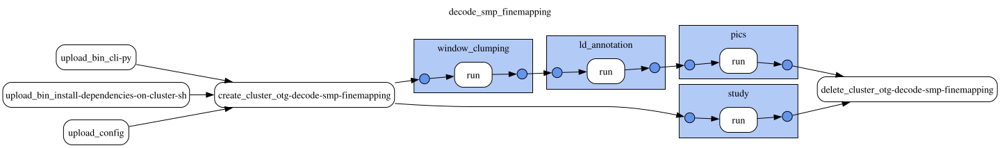

# deCODE SMP pQTL fine-mapping

This document was updated on 2026-11-03.

```sh
gs://decode_data/prod/20261103T122701/bin/                                 # gentropy CLI and cluster init script of the run
gs://decode_data/prod/20261103T122701/config/decode_smp_finemapping.yaml   # DAG config of the run
gs://decode_data/prod/20261103T122701/docs/
gs://decode_data/prod/20261103T122701/output/study/
gs://decode_data/prod/20261103T122701/output/study_locus/
gs://decode_data/prod/20261103T122701/output/ld_annotated_study_locus/
gs://decode_data/prod/20261103T122701/output/credible_set/
gs://decode_data/prod/20261103T122701/output/credible_set_variant/
```

The run fine-maps the median-normalised (`smp`) deCODE pQTL summary statistics with PICS, on gentropy [`v4.0.0-dev.13`](https://github.com/opentargets/gentropy/tree/v4.0.0-dev.13) and the new credible set schema (`CredibleSet` and `CredibleSetVariant`). The links below refer to that tag.

Data is produced by the **decode_smp_finemapping DAG**. It does not harmonise the summary statistics again: it reads the harmonised summary statistics, the pQTL study index and the target index of the frozen deCODE release of 2026-09-16 (gentropy `v3.4.0-dev.15`, see the [deCODE README](../README.md)). The `raw` summary statistics are not fine-mapped.

Inputs of the run:

```sh
gs://decode_data/prod/20260916T175627/output/smp/harmonised_summary_statistics/   # 5,278 studies, 2.8 TiB
gs://decode_data/prod/20260916T175627/output/smp/pqtl_study_qc_annotated/        # 4,961 studies
gs://decode_data/prod/20260916T175627/output/target/
gs://gnomad_data_2/v2.1.1/ld_index/
```

The DAG has 4 steps on one Dataproc cluster of 16 `n2d-highmem-16` workers:



| Step | gentropy step | Output | Run time |
|---|---|---|---|
| `study` | `pQTL_study_index_transformation` | `study` | 2 min |
| `window_clumping` | `window_based_clumping` | `study_locus` | 11 min |
| `ld_annotation` | `ld_based_clumping` | `ld_annotated_study_locus` | 2 min |
| `pics` | `pics` | `credible_set`, `credible_set_variant` | 2 min |

The cluster took 4 minutes to start; the whole run took 22 minutes, cluster deletion included.

## study

The step ([`pqtl_study.py`](https://github.com/opentargets/gentropy/blob/v4.0.0-dev.13/src/gentropy/pqtl_study.py)) turns the pQTL study index into the standard study index, with one row per target gene resolved with the target index. The output is identical to `smp/study` of the frozen release: 4,993 rows, 4,934 studies.

## window_clumping

The step ([`window_based_clumping.py`](https://github.com/opentargets/gentropy/blob/v4.0.0-dev.13/src/gentropy/window_based_clumping.py)) takes the leads at `p < 1.8e-9`, the study-wide threshold of the deCODE publications, 1 Mb apart. With `collect_locus=true`, each lead carries the summary statistics within 1 Mb into `locus`. In the v3 release the locus was not collected.

## ld_annotation

The step ([`ld_based_clumping.py`](https://github.com/opentargets/gentropy/blob/v4.0.0-dev.13/src/gentropy/ld_based_clumping.py)) adds the LD set of each lead from the gnomAD v2.1.1 LD index, in the population of the study (`nfe`), and flags the leads explained by a more significant lead at r² ≥ 0.5.

## pics

The step ([`pics.py`](https://github.com/opentargets/gentropy/blob/v4.0.0-dev.13/src/gentropy/pics.py)) fine-maps each lead into a 95% credible set. The members of a credible set take their reported statistics from `locus`. The leads explained by a more significant lead are not fine-mapped.

The LD annotation and PICS read the pQTL study index (`pqtl_study_qc_annotated`), not `study`: `study` has one row per gene of a multi-gene aptamer with the same `studyId`, and the study index join of PICS would duplicate their credible sets (489 credible sets). Both give the same `studyType` and LD population.

## Results

| | v3 (`prod/20260916T175627`) | v4 (this run) |
|---|---:|---:|
| credible sets | 46,336 | 46,333 |
| studies with credible sets | 5,133 | 5,133 |
| credible set variants | | 487,247 |

- 46,333 credible sets have the same study and lead in both releases. The 3 credible sets only in v3 were flagged "Explained by a more significant variant in high LD".
- Every credible set has variants, ids and `(credibleSetId, variantId)` are unique, the lead is a member of its credible set, and the posterior probabilities of each credible set sum to 0.95–1.0.

## Known issues

- 290 studies (2,102 credible sets) have no row in the study index, so their `studyType` is empty and they carry "Study does not have population annotation to resolve LD". Their summary statistics keep the study id derived from the file name, because their aptamers are not in the SomaScan study table (for example `deCODE-proteomics-smp_Proteomics_SMP_PC0_10021_1_SUSD2_SUSD2_10032022`). The same credible sets are in the v3 release.
- `study` has one row per gene of a multi-gene aptamer with the same `studyId`: 4,993 rows, 4,934 studies ([opentargets/issues#4595](https://github.com/opentargets/issues/issues/4595)).
- 3,582 credible set variants (0.7%) have no reported statistics: LD set members with no entry in the summary statistics.
- 23,506 credible sets carry "Variant not found in LD reference".

## Outputs

### credible_set

One row per credible set: `id`, `chromosome`, `locusStart`, `locusEnd`, `studyId`, `studyType`, `leadVariantId`, `fineMappingMethod` (`PICS`), `logBayesFactor`, `confidence`, `purityMeanR2`, `purityMinR2`, `qualityControls`. `logBayesFactor`, `confidence` and the purity fields are empty for PICS. 46,333 rows in 20 files.

### credible_set_variant

One row per member of a credible set, joined on `credibleSetId`: `variantId`, `pValueMantissa`, `pValueExponent`, `effectAlleleFrequency`, `sampleSize`, `reportedBeta`, `reportedStandardError`, `posteriorProbability`, `logBayesFactor`, `r2Overall`, `conditionalBeta`, `conditionalStandardError`, `rescaledAbsBeta`, `rescaledStandardError`, `rescaledDirection`, `qualityControls`. 487,247 rows in 20 files.

### study, study_locus, ld_annotated_study_locus

`study` follows the gentropy [StudyIndex schema](https://github.com/opentargets/gentropy/blob/v4.0.0-dev.13/src/gentropy/assets/schemas/study_index.json) (1 file). `study_locus` (200 files, 13 GB) and `ld_annotated_study_locus` (193 files) are the intermediate loci with `locus`, in the [annotated](https://github.com/opentargets/gentropy/blob/v4.0.0-dev.13/src/gentropy/assets/schemas/annotated_study_locus.json) and [LD annotated](https://github.com/opentargets/gentropy/blob/v4.0.0-dev.13/src/gentropy/assets/schemas/ld_annotated_study_locus.json) study locus schemas.
