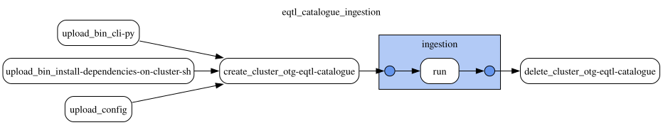

# EQTL Catalogue

This document was updated on 2026-11-05.

```sh
gs://eqtl_catalogue_data/r8/prod/20261105T130431/bin/                                 # gentropy cli.py and cluster init script of the run
gs://eqtl_catalogue_data/r8/prod/20261105T130431/config/eqtl_catalogue_ingestion.yaml # DAG config of the run
gs://eqtl_catalogue_data/r8/prod/20261105T130431/docs/
gs://eqtl_catalogue_data/r8/prod/20261105T130431/output/study_index/
gs://eqtl_catalogue_data/r8/prod/20261105T130431/output/credible_set/
gs://eqtl_catalogue_data/r8/prod/20261105T130431/output/credible_set_variant/
```

`r8/prod/20261105T130431/` is the DAG output, unpatched. It replaces the v4 run `r8/prod/20261030T164426/`, described in the README of earlier commits, whose 121,931 credible sets had no `locusStart` ([opentargets/issues#4652](https://github.com/opentargets/issues/issues/4652)) and whose duplicate QTS000038 credible sets were removed by a patch.

The run is in the gentropy v4 schema: credible sets (`credible_set`) and their variants (`credible_set_variant`). The releases still read the v3 run `r8/prod/20261029T162303/`, described in the README of earlier commits, until PIS and PTS read the v4 schema.

Data contained in the run is the [eQTL Catalogue](https://www.ebi.ac.uk/eqtl/) release 8 SuSiE fine-mapping, ingested as a study index, credible sets and credible set variants. The eQTL Catalogue r8 already contains GTEx v10, IBDverse and MAGE, so they are not ingested on their own.

Data is produced by the **eqtl_catalogue_ingestion DAG**. The DAG configuration is in `config/eqtl_catalogue_ingestion.yaml` of the run folder. The run uses gentropy [`v4.0.0-rc.2`](https://github.com/opentargets/gentropy/tree/v4.0.0-rc.2) (`GENTROPY_REF`), with the `pubmedId` fix ([opentargets/gentropy#1334](https://github.com/opentargets/gentropy/pull/1334)), one full SuSiE row per variant, region and trait ([opentargets/gentropy#1338](https://github.com/opentargets/gentropy/pull/1338)) and a negative region start parsed as a locus start of 1 ([opentargets/gentropy#1344](https://github.com/opentargets/gentropy/pull/1344)), and the [`eqtl_catalogue`](https://github.com/opentargets/gentropy/blob/v4.0.0-rc.2/src/gentropy/eqtl_catalogue.py) step; the links below refer to that tag.

Inputs of the run:

```sh
gs://eqtl_catalogue_processed_otar_internal_data/otar2077/eQTL_Catalogue_r8_260626/susie/QTS*/QTD*/QTD*.credible_sets.parquet
gs://eqtl_catalogue_processed_otar_internal_data/otar2077/eQTL_Catalogue_r8_260626/susie/QTS*/QTD*/QTD*.lbf_variable.parquet
gs://eqtl_catalogue_processed_otar_internal_data/otar2077/eQTL_Catalogue_r8_260626/susie_batches/QTS*/QTD*/QTD*.full_susie.parquet
https://raw.githubusercontent.com/eQTL-Catalogue/eQTL-Catalogue-resources/fd99d45d3e433dcdf3c3d0acb4db0b7d5e8a7bd3/data_tables/dataset_metadata_r8.tsv
```

The SuSiE results are the [qtlmap](https://github.com/eQTL-Catalogue/qtlmap) outputs in Parquet format, one folder per study (`QTS*`) and dataset (`QTD*`): 1,205 datasets with credible sets (6.6 GB) and log Bayes factors (1.5 TB), and 1,193 with the full SuSiE posterior (5.5 TB). The dataset metadata is the eQTL Catalogue r8 table of datasets, pinned to a commit.

The DAG has 1 step, run on one Dataproc cluster:



1. ingestion

## ingestion

The step, gentropy `eqtl_catalogue` ([`eqtl_catalogue.py`](https://github.com/opentargets/gentropy/blob/v4.0.0-rc.2/src/gentropy/eqtl_catalogue.py)) joins the SuSiE credible sets, their log Bayes factors, the full SuSiE posterior and the dataset metadata ([`finemapping.py`](https://github.com/opentargets/gentropy/blob/v4.0.0-rc.2/src/gentropy/datasource/eqtl_catalogue/finemapping.py), [`study_index.py`](https://github.com/opentargets/gentropy/blob/v4.0.0-rc.2/src/gentropy/datasource/eqtl_catalogue/study_index.py)):

- One study per dataset and molecular trait. `studyType` comes from the quantification method (gene expression, exon, transcript and microarray give `eqtl`; Leafcutter and MAJIQ give `sqtl`; txrevise gives `tuqtl`; aptamer gives `pqtl`), with an `sc` prefix for single-cell datasets.
- One credible set per SuSiE component (1 to 10) of a molecular trait in a region. The lead is the member with the top posterior probability, ties broken by variant id.
- The region is the gene TSS ± 1 Mb, `chrN:start-end`. For genes in the first megabase of a chromosome its start is negative ([eQTL-Catalogue/qtlmap#29](https://github.com/eQTL-Catalogue/qtlmap/issues/29)); `locusStart` is then 1.
- The full SuSiE posterior of QTS000038 (OneK1K) lists some members twice, with moments that differ only by floating point noise. One row per variant, region and trait is kept.
- Variants with alleles other than A, C, G and T (e.g. `<DEL>`, `<DUP>` in AFR_LCL/QTS000044 and MAGE/QTS000055) are removed from the credible sets, as they gave duplicate entries.
- Some studies (e.g. CommonMind/QTS000008, Kim-Hellmuth/QTS000042) report the SuSiE PIP instead of the per-component alpha. Their posterior probabilities are recomputed from the log Bayes factors, so they sum to at most 1 per credible set ([opentargets/issues#4496](https://github.com/opentargets/issues/issues/4496)).
- The conditional statistics of a member are the SuSiE posterior mean and standard deviation of the credible set's own effect, from the full SuSiE posterior, on the scale SuSiE was fitted on.
- A credible set whose lead has a p-value above 1e-3 (`lead_pvalue_threshold`) is dropped. The v3 run flagged them `Subsignificant p-value` instead.

## Contents of the run 20261105T130431

| Study type | Studies | Credible sets |
|---|---:|---:|
| `eqtl` | 1,733,667 | 2,138,792 |
| `sqtl` | 1,250,077 | 1,436,388 |
| `tuqtl` | 555,286 | 630,225 |
| `sceqtl` | 171,346 | 194,925 |
| `pqtl` | 801 | 1,624 |
| Total | 3,711,177 | 4,401,954 |

- 98,043,317 credible set variants: 1 to 4,931 per credible set, median 8.
- 58 projects (`projectId`), including `GTEx_v10` (1,949,884 studies), `IBDverse` (65,216) and `MAGE` (60,243).
- The study index has the same studies and values as the v3 run `20261029T162303`, except `biosampleFromSourceId` of the 11 `Natri_2024` studies: the string `NaN` in v3, null here. `pubmedId` is a whole number, and null for the 100,256 studies of `AFR_LCL`, which has no PubMed id in the eQTL Catalogue metadata.
- `id` of `credible_set` and (`credibleSetId`, `variantId`) of `credible_set_variant` are unique. Every credible set has a study and variants, and every variant has a credible set. 241 studies have no credible set; every v3 credible set of these studies has a lead p-value above 1e-3.
- 4,401,954 credible sets is the number of v3 credible sets with a lead p-value of at most 1e-3. 38 credible sets in each direction cross the threshold, because v3 and v4 break ties of the top posterior probability differently.
- Chromosomes `1` to `22` and `X`. `locusStart` is set for every credible set, and is 1 for 121,931.
- The posterior probabilities of a credible set sum to 0.95 to 1 for 4,398,811 sets, and to more than 1 for none. 3,143 sets sum to less than 0.95, 2,100 to less than 0.94, mostly in QTS000055 (1,260) and QTS000044 (710), where members with non-ATGC alleles were removed.
- Against the v3 run `20261029T162303`, the 4,401,916 credible sets in both runs have the same members, p-values, `reportedBeta` and `reportedStandardError`; posterior probabilities differ by at most 3e-8. 529,094 of them have a different lead of the same top posterior probability: v4 breaks the tie by variant id.
- Against the v4 run `20261030T164426`, only the 121,931 credible sets with a negative region start change, `locusStart` (null to 1) and `id`.
- `conditionalBeta` and `conditionalStandardError` are null for 1.2% of variants, those of the 12 datasets with no full SuSiE posterior.
- Null in every row: `confidence` and `purityMeanR2` of `credible_set`; `effectAlleleFrequency`, `sampleSize`, `r2Overall` and the rescaled statistics of `credible_set_variant`. `qualityControls` is empty.

## Outputs

### study_index

One row per dataset and molecular trait.

| Column | Type | Description |
|---|---|---|
| `studyId` | `string` | `<study>_<dataset>_<dataset label>_<molecular trait>` in lower case, e.g. `qts000044_qtd000764_mage_ge_lcl_ensg00000273841`. |
| `projectId` | `string` | Study label of the eQTL Catalogue, e.g. `GTEx_v10`, `MAGE`, `BLUEPRINT`. |
| `studyType` | `string` | `eqtl`, `sqtl`, `tuqtl`, `sceqtl` or `pqtl`. |
| `traitFromSource` | `string` | Molecular trait id of the eQTL Catalogue: gene, exon, transcript, intron or event. |
| `geneId` | `string` | Ensembl gene id of the molecular trait. |
| `biosampleFromSourceId` | `string` | Tissue or cell type ontology term (UBERON, CL, EFO). |
| `condition` | `string` | Condition of the samples, e.g. `naive`, `sepsis`, `LPS_24h`. |
| `pubmedId` | `string` | PubMed id of the study; null for `AFR_LCL`. |
| `nSamples` | `integer` | Sample size of the dataset. |
| `summarystatsLocation` | `string` | eQTL Catalogue FTP folder of the summary statistics of the dataset. They are not ingested. |
| `hasSumstats` | `boolean` | `true`. |

### credible_set

One row per credible set, in the gentropy v4 [`CredibleSet`](https://github.com/opentargets/gentropy/blob/v4.0.0-rc.2/src/gentropy/dataset/credible_set.py) schema.

| Column | Type | Description |
|---|---|---|
| `id` | `string` | Identifier of the credible set: an MD5 hash of `studyId`, `chromosome`, `locusStart`, `locusEnd`, `leadVariantId` and `fineMappingMethod`. |
| `chromosome` | `string` | Chromosome of the region. |
| `locusStart` | `integer` | Start of the fine-mapped region on GRCh38; 1 when the region starts before the chromosome. |
| `locusEnd` | `integer` | End of the fine-mapped region on GRCh38. |
| `studyId` | `string` | Study of the credible set, as in `study_index`. |
| `studyType` | `string` | As in `study_index`. |
| `leadVariantId` | `string` | Lead variant, `<chromosome>_<position>_<ref>_<alt>` on GRCh38. |
| `fineMappingMethod` | `string` | `SuSiE`. |
| `logBayesFactor` | `double` | Log Bayes factor of the credible set. |
| `confidence` | `byte` | Null. |
| `purityMeanR2` | `double` | Null. |
| `purityMinR2` | `double` | Smallest r2 between the members, from the source (`cs_min_r2`). |
| `qualityControls` | `array<string>` | Empty. |

### credible_set_variant

One row per member of a credible set, in the gentropy v4 [`CredibleSetVariant`](https://github.com/opentargets/gentropy/blob/v4.0.0-rc.2/src/gentropy/dataset/credible_set.py) schema.

| Column | Type | Description |
|---|---|---|
| `credibleSetId` | `string` | `id` of the credible set. |
| `variantId` | `string` | Member, `<chromosome>_<position>_<ref>_<alt>` on GRCh38. |
| `pValueMantissa` | `float` | Mantissa of the marginal p-value (p = mantissa × 10^exponent). |
| `pValueExponent` | `integer` | Exponent of the marginal p-value. |
| `effectAlleleFrequency` | `float` | Null: the source gives only the minor allele frequency. |
| `sampleSize` | `integer` | Null: the source gives no sample size per variant. |
| `reportedBeta` | `double` | Marginal effect size reported by the study. |
| `reportedStandardError` | `double` | Standard error of `reportedBeta`. |
| `posteriorProbability` | `float` | Posterior probability of the member in the credible set. |
| `logBayesFactor` | `float` | Log Bayes factor of the member for the SuSiE component of the credible set. |
| `r2Overall` | `float` | Null. |
| `conditionalBeta` | `float` | SuSiE posterior mean of the effect of the credible set, unscaled; null for the 12 datasets with no full SuSiE posterior. |
| `conditionalStandardError` | `float` | SuSiE posterior standard deviation of that effect, unscaled; null as `conditionalBeta`. |
| `rescaledAbsBeta` | `float` | Null. |
| `rescaledStandardError` | `float` | Null. |
| `rescaledDirection` | `byte` | Null. |
| `qualityControls` | `array<string>` | Empty. |

## Changelog

### 2026-11-05

- fix: rerun r8 on gentropy v4.0.0-rc.2 into `gs://eqtl_catalogue_data/r8/prod/20261105T130431/`. A negative region start is parsed as a `locusStart` of 1, so 121,931 credible sets get a start and a new `id` ([opentargets/issues#4652](https://github.com/opentargets/issues/issues/4652)). The duplicate QTS000038 credible sets are no longer written, so the run needs no patch.

### 2026-10-30

- feat: rerun r8 in the gentropy v4 schema with the staging DAG into `gs://eqtl_catalogue_data/r8/prod/20261030T153207/`, with the conditional statistics from the full SuSiE posterior. Credible sets with a lead p-value above 1e-3 are dropped instead of flagged.
- fix: patch the duplicate QTS000038 credible sets into `gs://eqtl_catalogue_data/r8/prod/20261030T164426/`.
- docs: 58 projects, not 59 as written on 2026-10-29.

### 2026-10-29

- fix: patch `pubmedId` of the r8 study index into `gs://eqtl_catalogue_data/r8/prod/20261029T162303/`, which the releases read.
- chore: copy the r8 run of 2026-08-22 from `gs://eqtl_catalogue_data/r8/` to `gs://eqtl_catalogue_data/r8/prod/20260822T223458/` (`config/`, `docs/`, `output/`). The public release now reads r8 instead of r7, and no longer reads GTEx v10, IBDverse and MAGE on their own; the PPP release reads the same run. The r7 outputs and the other old folders at the root of the bucket are described in the README of earlier commits.

### 2025-02-05

- [fix: reclassify eqtl catalogue sc datasets #894](https://github.com/opentargets/gentropy/pull/894)
- [feat(qtls): flagging trans QTL credible sets #973](https://github.com/opentargets/gentropy/pull/973)
- [chore: removing symbols from QTL study identifiers #971](https://github.com/opentargets/gentropy/pull/971)
- [refactor(eqtl catalogue): update dag structure for r8 release](https://github.com/opentargets/issues/issues/4421)
