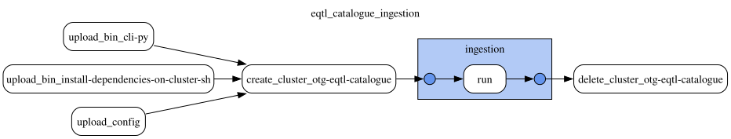

# EQTL Catalogue

This document was updated on 2026-10-29.

```sh
gs://eqtl_catalogue_data/r8/prod/20260822T223458/config/eqtl_catalogue_ingestion.yaml # DAG config of the run
gs://eqtl_catalogue_data/r8/prod/20260822T223458/docs/
gs://eqtl_catalogue_data/r8/prod/20260822T223458/output/study_index/
gs://eqtl_catalogue_data/r8/prod/20260822T223458/output/credible_set/
```

Data contained in the run is the [eQTL Catalogue](https://www.ebi.ac.uk/eqtl/) release 8 SuSiE fine-mapping, ingested as a study index and credible sets. Both the public and the PPP release read this run. The eQTL Catalogue r8 already contains GTEx v10, IBDverse and MAGE, so they are not ingested on their own.

Data is produced by the **eqtl_catalogue_ingestion DAG**. The DAG configuration is in `config/eqtl_catalogue_ingestion.yaml` of the run folder. The run uses gentropy [`v3.4.0-dev.4`](https://github.com/opentargets/gentropy/tree/v3.4.0-dev.4) (`GENTROPY_REF`) and the [`eqtl_catalogue`](https://github.com/opentargets/gentropy/blob/v3.4.0-dev.4/src/gentropy/eqtl_catalogue.py) step; the links below refer to that tag. The run wrote its outputs on 2026-08-22 to `gs://eqtl_catalogue_data/r8/`; they were copied unchanged into the run folder on 2026-10-29.

Inputs of the run:

```sh
gs://eqtl_catalogue_processed_otar_internal_data/otar2077/eQTL_Catalogue_r8_260626/susie/QTS*/QTD*/QTD*.credible_sets.parquet
gs://eqtl_catalogue_processed_otar_internal_data/otar2077/eQTL_Catalogue_r8_260626/susie/QTS*/QTD*/QTD*.lbf_variable.parquet
https://raw.githubusercontent.com/eQTL-Catalogue/eQTL-Catalogue-resources/fd99d45d3e433dcdf3c3d0acb4db0b7d5e8a7bd3/data_tables/dataset_metadata_r8.tsv
```

The SuSiE results are the [qtlmap](https://github.com/eQTL-Catalogue/qtlmap) outputs in Parquet format, one folder per study (`QTS*`) and dataset (`QTD*`). The dataset metadata is the eQTL Catalogue r8 table of datasets, pinned to a commit.

The DAG has 1 step, run on one Dataproc cluster:



1. eqtl_catalogue

## eqtl_catalogue

The step ([`eqtl_catalogue.py`](https://github.com/opentargets/gentropy/blob/v3.4.0-dev.4/src/gentropy/eqtl_catalogue.py)) joins the SuSiE credible sets, their log Bayes factors and the dataset metadata ([`finemapping.py`](https://github.com/opentargets/gentropy/blob/v3.4.0-dev.4/src/gentropy/datasource/eqtl_catalogue/finemapping.py), [`study_index.py`](https://github.com/opentargets/gentropy/blob/v3.4.0-dev.4/src/gentropy/datasource/eqtl_catalogue/study_index.py)):

- One study per dataset and molecular trait. `studyType` comes from the quantification method (gene expression, exon, transcript and microarray give `eqtl`; Leafcutter and MAJIQ give `sqtl`; txrevise gives `tuqtl`; aptamer gives `pqtl`), with an `sc` prefix for single-cell datasets.
- One credible set per SuSiE component (`credibleSetIndex` 1 to 10) of a molecular trait in a region. The lead is the member with the top posterior probability.
- Variants with alleles other than A, C, G and T (e.g. `<DEL>`, `<DUP>` in AFR_LCL/QTS000044 and MAGE/QTS000055) are removed from the credible sets, as they gave duplicate entries.
- Some studies (e.g. CommonMind/QTS000008, Kim-Hellmuth/QTS000042) report the SuSiE PIP instead of the per-component alpha. Their posterior probabilities are recomputed from the log Bayes factors, so they sum to at most 1 per credible set ([opentargets/issues#4496](https://github.com/opentargets/issues/issues/4496)).
- A credible set whose lead has a p-value above 1e-3 (`lead_pvalue_threshold`) is flagged `Subsignificant p-value`.

## Contents of the run 20260822T223458

| Study type | Studies | Credible sets |
|---|---:|---:|
| `eqtl` | 1,733,667 | 2,251,458 |
| `sqtl` | 1,250,077 | 1,482,107 |
| `tuqtl` | 555,286 | 650,990 |
| `sceqtl` | 171,346 | 210,789 |
| `pqtl` | 801 | 1,772 |
| Total | 3,711,177 | 4,597,116 |

- 59 projects (`projectId`), including `GTEx_v10` (1,949,884 studies), `IBDverse` (65,216) and `MAGE` (60,243).
- `studyId` and `studyLocusId` are unique. Every credible set has a study, and every study has at least one credible set.
- Chromosomes `1` to `22` and `X`.
- 195,162 credible sets are flagged `Subsignificant p-value`.
- The posterior probabilities of a credible set sum to 0.95 to 1 for 99% of sets. 2,182 sets sum to less than 0.94, mostly in QTS000055 (1,311) and QTS000044 (736), where members with non-ATGC alleles were removed.
- Known issues: `pubmedId` is a number written as a float string (`3.2913098E7` for PubMed 32913098), and it is `NaN` for the 100,256 studies of `AFR_LCL`.

## Outputs

### study_index

One row per dataset and molecular trait.

| Column | Type | Description |
|---|---|---|
| `studyId` | `string` | `<study>_<dataset>_<dataset label>_<molecular trait>` in lower case, e.g. `qts000044_qtd000764_mage_ge_lcl_ensg00000273841`. |
| `projectId` | `string` | Study label of the eQTL Catalogue, e.g. `GTEx_v10`, `MAGE`, `BLUEPRINT`. |
| `studyType` | `string` | `eqtl`, `sqtl`, `tuqtl`, `sceqtl` or `pqtl`. |
| `traitFromSource` | `string` | Molecular trait id of the eQTL Catalogue: gene, exon, transcript, intron or event. |
| `geneId` | `string` | Ensembl gene id of the molecular trait. |
| `biosampleFromSourceId` | `string` | Tissue or cell type ontology term (UBERON, CL, EFO). |
| `condition` | `string` | Condition of the samples, e.g. `naive`, `sepsis`, `LPS_24h`. |
| `pubmedId` | `string` | PubMed id of the study, as a float string (see Known issues). |
| `nSamples` | `integer` | Sample size of the dataset. |
| `summarystatsLocation` | `string` | eQTL Catalogue FTP folder of the summary statistics of the dataset. They are not ingested. |
| `hasSumstats` | `boolean` | `true`. |

### credible_set

One row per credible set, in the gentropy v3 [`StudyLocus`](https://github.com/opentargets/gentropy/blob/v3.4.0-dev.4/src/gentropy/dataset/study_locus.py) schema.

| Column | Type | Description |
|---|---|---|
| `studyLocusId` | `string` | Identifier of the credible set: a hash of `studyId`, `variantId` and `finemappingMethod`. |
| `studyId` | `string` | Study of the credible set, as in `study_index`. |
| `studyType` | `string` | As in `study_index`. |
| `variantId` | `string` | Lead variant, `<chromosome>_<position>_<ref>_<alt>` on GRCh38. |
| `chromosome` | `string` | Chromosome of the lead variant. |
| `position` | `integer` | Position of the lead variant on GRCh38. |
| `region` | `string` | Fine-mapped window, e.g. `chr1:8943407-10943407`. |
| `beta` | `double` | Effect size of the lead. |
| `standardError` | `double` | Standard error of `beta`. |
| `pValueMantissa` | `float` | Mantissa of the p-value of the lead (p = mantissa × 10^exponent). |
| `pValueExponent` | `integer` | Exponent of the p-value of the lead. |
| `finemappingMethod` | `string` | `SuSie`. |
| `credibleSetIndex` | `integer` | SuSiE component, 1 to 10. |
| `credibleSetlog10BF` | `double` | log10 Bayes factor of the credible set, from the `logBF` of its members. |
| `qualityControls` | `array<string>` | Empty, or `Subsignificant p-value`. |
| `locus` | `array<struct<variantId: string, posteriorProbability: double, pValueMantissa: float, pValueExponent: integer, logBF: double, beta: double, standardError: double, is95CredibleSet: boolean, is99CredibleSet: boolean>>` | Members of the credible set (1 to 4,931, median 8), with their posterior probability, log Bayes factor and summary statistics, and whether they are in the 95% and 99% credible sets. |

## Changelog

### 2026-10-29

- chore: copy the r8 run of 2026-08-22 from `gs://eqtl_catalogue_data/r8/` to `gs://eqtl_catalogue_data/r8/prod/20260822T223458/` (`config/`, `docs/`, `output/`). The public release now reads r8 from the run folder instead of r7, and no longer reads GTEx v10, IBDverse and MAGE on their own; the PPP release reads the same run. The r7 outputs and the other old folders at the root of the bucket are described in the README of earlier commits.

### 2025-02-05

- [fix: reclassify eqtl catalogue sc datasets #894](https://github.com/opentargets/gentropy/pull/894)
- [feat(qtls): flagging trans QTL credible sets #973](https://github.com/opentargets/gentropy/pull/973)
- [chore: removing symbols from QTL study identifiers #971](https://github.com/opentargets/gentropy/pull/971)
- [refactor(eqtl catalogue): update dag structure for r8 release](https://github.com/opentargets/issues/issues/4421)
