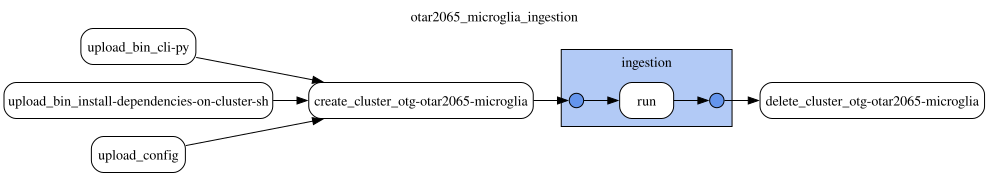

# OTAR2065 microglia single-cell eQTLs

This document was updated on 2026-11-03.

Single-cell eQTLs of human microglia from the OTAR2065 neuroinflammation project, in three conditions (IFN, LPS, untreated), each split into proliferating and non-proliferating cells. There is no publication. The data is read by the Partner Preview Platform (PPP) only.

The eQTL Catalogue team (OTAR2077) mapped the eQTLs with their [qtlmap](https://github.com/eQTL-Catalogue/qtlmap) pipeline on 2025-02-01 (70 phenotype PCs, 6 genotype PCs, 1 Mb cis window, SuSiE with the full output written). Each condition and proliferation state is one eQTL Catalogue dataset (`QTD000759` to `QTD000763`), not in the public eQTL Catalogue.

## Run folder

The release read by `pis` was produced in 2025, outside of this repository, with gentropy 2.x, and written to `gs://eqtl_catalogue_processed_otar_internal_data/otar2077/microglia/gentropy/`. It was copied into a dated run folder of `gs://eqtl_catalogue_data` on 2026-11-03, before the dataset moves to the new credible set schema. Nothing in it was changed.

```sh
gs://eqtl_catalogue_data/otar2065_microglia/prod/20250624T124201/
├── docs/     README.md
└── output/
    ├── study_index/QTD*/    # written 2025-05-15
    ├── study_locus/QTD*/    # written 2025-06-24, gentropy StudyLocus
    └── coloc/QTD*/          # written 2025-04-16, not read by the platform
```

The timestamp is the time of the last write of the release (`study_locus`, 2025-06-24T12:42:01Z).

## Inputs

The qtlmap output was synced on 2026-11-03 from `gs://eqtl_catalogue_processed_otar_internal_data/otar2077/microglia/` (all of it but `gentropy/`, the release frozen above) to `gs://eqtl_catalogue_data/otar2065_microglia/source/`, with the dataset metadata of the v4 ingestion:

```sh
gs://eqtl_catalogue_data/otar2065_microglia/source/susie/QTD*_credible_sets.parquet
gs://eqtl_catalogue_data/otar2065_microglia/source/susie/QTD*_lbf_variable_merged.parquet
gs://eqtl_catalogue_data/otar2065_microglia/source/susie_batches/QTD*/{cs,lbf,full}/
gs://eqtl_catalogue_data/otar2065_microglia/source/sumstats/QTD*/all/
gs://eqtl_catalogue_data/otar2065_microglia/source/{lead_cc_signal,PCA,varinfo,Documentation,pipeline_info}/
gs://eqtl_catalogue_data/otar2065_microglia/source/dataset_metadata.tsv
```

The datasets are not in the eQTL Catalogue metadata, so `dataset_metadata.tsv` describes them in its format, with the values of the frozen study index and `study_id` `OTAR2065`:

| dataset_id | sample_group | tissue_id | condition_label | sample_size |
|---|---|---|---|---:|
| QTD000759 | microglia_IFN_nonProlif | CL_0000129 | IFN | 211 |
| QTD000760 | microglia_LPS_Prolif | CL_0000129 | LPS | 131 |
| QTD000761 | microglia_LPS_nonProlif | CL_0000129 | LPS | 207 |
| QTD000762 | microglia_untreated_Prolif | CL_0000129 | untreated | 149 |
| QTD000763 | microglia_untreated_nonProlif | CL_0000129 | untreated | 208 |

The other columns are the same for every dataset: `study_label` `OTAR2065_neuroinflammation`, `tissue_label` `microglial cell`, `quant_method` `ge`, `study_type` `single-cell`, no `pmid`.

The SuSiE files have the same schemas as those of the eQTL Catalogue r8 release.

## Release

| Dataset | Sample group | Condition | Samples | Studies | Credible sets |
|---|---|---|---:|---:|---:|
| `QTD000759` | `microglia_IFN_nonProlif` | IFN | 211 | 2,429 | 3,599 |
| `QTD000760` | `microglia_LPS_Prolif` | LPS | 131 | 287 | 1,227 |
| `QTD000761` | `microglia_LPS_nonProlif` | LPS | 207 | 2,507 | 3,714 |
| `QTD000762` | `microglia_untreated_Prolif` | untreated | 149 | 402 | 1,119 |
| `QTD000763` | `microglia_untreated_nonProlif` | untreated | 208 | 3,150 | 4,741 |
| **total** | | | | **8,775** | **14,400** |

- One study per sample group and gene: `OTAR2065_neuroinflammation_ge_<sample group>_<ENSG>`, project `OTAR2065_neuroinflammation`, study type `sceqtl`, biosample `CL_0000129` (microglial cell).
- 394,699 credible set members, every one with beta, standard error and p-value; the posterior probabilities of each credible set sum to 0.95–1.0. `finemappingMethod` is `SuSie`.

## Known issues

- 3,293 credible sets carry the quality control `Subsignificant p-value` and are still in the release; the threshold used is not recorded.
- `study_index` once held every study twice, under the projects `microglia` and `OTAR2065_neuroinflammation` ([opentargets/issues#3924](https://github.com/opentargets/issues/issues/3924)). The frozen copy has only `OTAR2065_neuroinflammation`, with unique study ids.

## v4 ingestion

The DAG `otar2065_microglia_ingestion` runs the gentropy `eqtl_catalogue` step on the qtlmap output, as for the eQTL Catalogue r8 release, into `CredibleSet` and `CredibleSetVariant`:

```sh
gs://eqtl_catalogue_data/otar2065_microglia/prod/20261103T163322/
├── bin/      gentropy CLI and cluster init script of the run
├── config/   otar2065_microglia_ingestion.yaml (the DAG config of the run)
├── docs/     README.md + DAG svg
└── output/{study_index, credible_set, credible_set_variant}
```



- gentropy commit `b8d49acab42b8357ce999e3ab9995dca235f9e7a` ([opentargets/gentropy#1343](https://github.com/opentargets/gentropy/pull/1343)), one cluster of 8 `n2d-highmem-16` workers; the run took 7 minutes.
- Inputs: `susie/QTD*_credible_sets.parquet`, `susie/QTD*_lbf_variable_merged.parquet`, `susie_batches/QTD*/full/QTD*.full_susie.parquet` and `dataset_metadata.tsv` of `source/` (see [Inputs](#inputs)).
- `lead_pvalue_threshold` 1e-3, as for r8. `summary_statistics_location` is null: the summary statistics are not public, so the studies have no `summarystatsLocation` and `hasSumstats` is false.
- `reportedBeta` and `reportedStandardError` are the marginal effects of the qtlmap credible sets; `conditionalBeta` and `conditionalStandardError` come from the full SuSiE output, for every member. `effectAlleleFrequency` is empty, as in r8.
- Study identifiers follow the eQTL Catalogue ingestion and are lower case: `otar2065_<QTD>_otar2065_neuroinflammation_ge_<sample group>_<ENSG>`. They differ from the frozen release.

| | v4 | frozen release | frozen, without `Subsignificant p-value` |
|---|---:|---:|---:|
| `QTD000759` | 3,055 | 3,599 | 3,058 |
| `QTD000760` | 351 | 1,227 | 351 |
| `QTD000761` | 3,154 | 3,714 | 3,163 |
| `QTD000762` | 519 | 1,119 | 520 |
| `QTD000763` | 4,011 | 4,741 | 4,015 |
| credible sets | 11,090 | 14,400 | 11,107 |
| credible set variants | 328,270 | 394,699 | |
| studies | 8,775 | 8,775 | |

- 11,087 credible sets have the same dataset, gene and lead in both. The 3,293 credible sets flagged `Subsignificant p-value` in the frozen release are not in v4.
- 17 credible sets of the frozen release are not in v4: their lead p-value is 1.001e-3 to 1.049e-3 in the qtlmap output, stored rounded to 1.0e-3 in the frozen release, so it passed the 1e-3 filter there.
- 3 credible sets have another lead in v4; the frozen lead is a member of the v4 credible set.
- Every credible set has variants and a study, ids are unique, the lead is a member of its credible set, and the posterior probabilities of each credible set sum to 0.95–1.0. One study, of `QTD000763`, has no credible set left after the lead p-value filter.

## Changelog

### 2026-11-03

* Copied the release from `gs://eqtl_catalogue_processed_otar_internal_data/otar2077/microglia/gentropy/` into the run folder `gs://eqtl_catalogue_data/otar2065_microglia/prod/20250624T124201/`. `pis` reads the run folder. The source folder is not changed.

### 2026-11-03 (v4 ingestion)

* New DAG `otar2065_microglia_ingestion`: the gentropy `eqtl_catalogue` step on the qtlmap output, into `gs://eqtl_catalogue_data/otar2065_microglia/prod/20261103T163322/`, see [v4 ingestion](#v4-ingestion). `pis` keeps reading the frozen release until PTS reads `CredibleSet` and `CredibleSetVariant`.
