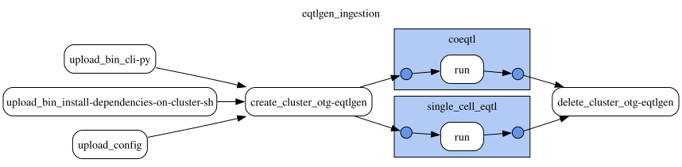

# eQTLGen single-cell eQTL and co-eQTL ingestion

This document was updated on 2026-11-03.

```sh
gs://eqtlgen_data/prod/20261103T135048/bin/                                  # gentropy CLI and cluster init script of the run
gs://eqtlgen_data/prod/20261103T135048/config/eqtlgen_ingestion.yaml         # DAG config of the run
gs://eqtlgen_data/prod/20261103T135048/docs/
gs://eqtlgen_data/prod/20261103T135048/output/{single_cell_eqtl,coeqtl}/study/
gs://eqtlgen_data/prod/20261103T135048/output/{single_cell_eqtl,coeqtl}/credible_set/
gs://eqtlgen_data/prod/20261103T135048/output/{single_cell_eqtl,coeqtl}/credible_set_variant/
```

The run ingests the SuSiE fine-mapping of the eQTLGen consortium single-cell eQTLs and co-eQTLs into the new credible set schema (`CredibleSet` and `CredibleSetVariant`). It replaces the release made by hand in a notebook, kept in `gs://eqtlgen_data/prod/20260326T115635/` (see the [eQTLGen README](../README.md)).

Data is produced by the **eqtlgen_ingestion DAG**, with the gentropy step `eqtlgen_ingestion` ([opentargets/gentropy#1342](https://github.com/opentargets/gentropy/pull/1342), commit `9f32c7fc76b06165c20f71e6a2cca046bb6713be`).

Inputs of the run:

```sh
gs://eqtlgen_data/raw_data/finemap_{B,CD4_T,CD8_T,DC,Mono,NK}/*.txt                    # single_cell_eqtl, 132 files
gs://eqtlgen_data/raw_data/joint_co_eQTL_fine_mapping_{B,CD4_T,CD8_T,Mono,NK}_*/*.txt  # coeqtl, 97 files
gs://open-targets-pipeline-runs/do/platform-2610-2/output/target/                     # gene symbols of the coeqtl
```

The DAG has 2 steps on one Dataproc cluster of 4 `n2d-highmem-16` workers, one per dataset:



The run took 8 minutes: 4 minutes to start the cluster and about 1 minute per step.

## Ingestion

One study per cell type and feature with credible sets: a gene for `single_cell_eqtl` (`eQTLGen_<cell type>_<ENSG>`), a pair of genes for `coeqtl` (`eQTLGen_<cell type>_<eGene>_<coeGene>`). The study identifiers are those of the previous release. Both have the study type `sceqtl`.

- **Credible sets** are those reported by eQTLGen (`SusieRss_CS`). `SusieRss_CS` numbers the credible sets of a feature, not the SuSiE effects `lbf_cs_1` to `lbf_cs_5`, so each credible set takes the effect in which its members hold the most posterior probability. The posterior probabilities are the softmax of the effect's log Bayes factors over every variant tested for the feature, and the credible set log Bayes factor is over the same variants.
- **Filters**, as in the previous release: lead p-value at most 0.01, credible set log10 Bayes factor at least 2 / ln(10). Credible sets whose members hold less than 0.95 of their effect are dropped: when two credible sets share variants, eQTLGen lists a variant under one of them only (9 `single_cell_eqtl` credible sets).
- **Alleles**: `snp_id` is `chromosome:position:reference:alternative` on GRCh38 and `assessed_allele` is the reference allele, so the `single_cell_eqtl` betas are flipped to the alternative allele of `variantId`. `coeqtl` gives z-scores only, so it has no `reportedBeta`.
- **Genes**: the `coeqtl` `eGene` symbol is mapped to the gene named by it (approved, then obsolete) on the chromosome of the feature and overlapping it.
- **Sample size**: per variant in `sampleSize`; per study, the largest of its variants (it varies by variant in the `coeqtl` meta-analysis).
- **Biosamples**: B `CL_0000236`, CD4 T `CL_0000624`, CD8 T `CL_0000625`, DC `CL_0000451`, Mono `CL_0000576`, NK `CL_0000623`.

## Results

| | `single_cell_eqtl` | `coeqtl` |
|---|---:|---:|
| credible sets | 13,821 | 15,393 |
| studies | 10,727 | 14,884 |
| credible set variants | 213,543 | 263,102 |
| members per credible set, median (max) | 6 (443) | 2 (333) |

Every credible set has variants and a study, the ids are unique, the lead is a member of its credible set, and the posterior probabilities of each credible set sum to 0.95–1.0.

### Comparison with the release `260326`

| | `single_cell_eqtl` | `coeqtl` |
|---|---:|---:|
| credible sets, `260326` | 16,246 | 15,191 |
| same study and lead | 13,821 | 15,190 |
| only in `260326` | 2,425 | 1 |
| only in this run | 0 | 203 |
| same `geneId` (studies in both) | 10,727 of 10,727 | 14,866 of 14,866 |

- `single_cell_eqtl`: the 2,425 credible sets only in `260326` are not eQTLGen credible sets. The notebook made a credible set of every SuSiE effect, with a cumulative posterior probability of 0.99, whether eQTLGen reported it or not. Their leads have no `SusieRss_CS`. Every lead of this run is a member of a `260326` credible set of the same study.
- `single_cell_eqtl`: all 13,821 leads in both have a `reportedBeta` of the opposite sign to the `beta` of `260326`, which was the effect of the reference allele.
- `coeqtl`, the 203 credible sets only in this run:
  - 183 have a lead p-value written `0` by eQTLGen. The notebook split it into a mantissa and an exponent of 0, and the filter `pValueExponent <= -3` dropped them; here it is the smallest double, `2.225e-308`. These are the strongest signals.
  - 1 has a lead p-value of exactly 0.01, kept by `p <= 0.01` and dropped by `pValueExponent <= -3`.
  - 18 are the credible sets of `eGene` FAM153B, not in the `260326` release, which joined on the target index.
  - 1 is the credible set of `eQTLGen_CD8_GNLY_ZEB2` that is only in `260326` with another lead: there, lead `2_85705825_T_C` and log10 Bayes factor 26.0, from the wrong SuSiE effect (`lbf_cs_2`); here, lead `2_85706244_A_G` and log10 Bayes factor 134.4.

## Known issues

- 18 `coeqtl` studies of `eGene` FAM153B have no `geneId`: the symbol is not in the target index of `do/platform-2610-2`.
- eQTLGen gives no effect allele frequency, conditional effects or purity, so these are empty.
- `gs://eqtlgen_data/prod/20261103T133828/` is an earlier run, without the 0.95 filter of the credible sets.

## Outputs

`study`, `credible_set` and `credible_set_variant` follow the gentropy [StudyIndex](https://github.com/opentargets/gentropy/blob/9f32c7fc76b06165c20f71e6a2cca046bb6713be/src/gentropy/assets/schemas/study_index.json), [CredibleSet](https://github.com/opentargets/gentropy/blob/9f32c7fc76b06165c20f71e6a2cca046bb6713be/src/gentropy/assets/schemas/credible_set.json) and [CredibleSetVariant](https://github.com/opentargets/gentropy/blob/9f32c7fc76b06165c20f71e6a2cca046bb6713be/src/gentropy/assets/schemas/credible_set_variant.json) schemas. Empty columns: `credible_set` `confidence`, `purityMeanR2`, `purityMinR2`; `credible_set_variant` `effectAlleleFrequency`, `r2Overall`, `conditionalBeta`, `conditionalStandardError`, `rescaled*`, and `reportedBeta`, `reportedStandardError` for `coeqtl`.
