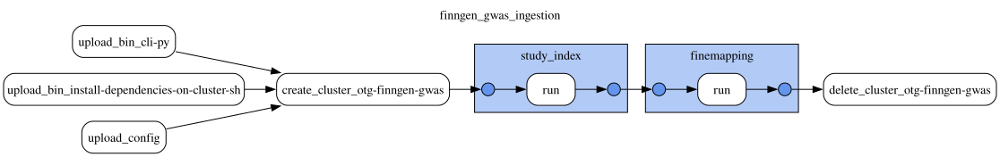

# FinnGen GWAS

This document was updated on 2026-10-31.

```sh
gs://finngen_data/gwas/prod/20261029T152531/bin/                               # gentropy CLI and cluster init script of the run
gs://finngen_data/gwas/prod/20261029T152531/config/finngen_gwas_ingestion.yaml # DAG config of the run
gs://finngen_data/gwas/prod/20261029T152531/docs/
gs://finngen_data/gwas/prod/20261029T152531/output/study/
gs://finngen_data/gwas/prod/20261029T152531/output/credible_set/
gs://finngen_data/gwas/prod/20261029T152531/output/credible_set_variant/
```

Data contained in `gwas` corresponds to the SuSiE fine-mapping results of [FinnGen Data Freeze 12](https://r12.finngen.fi/) (November 4 2024), published by FinnGen in `gs://finngen-public-data-r12/`.

Data is produced by **finngen_gwas_ingestion DAG**. The DAG configuration and topology are in `config/finngen_gwas_ingestion.yaml` of the run folder (`gs://finngen_data/gwas/prod/20261029T152531/config/`). The run of 2026-10-31 uses gentropy [`v4.0.0-dev.11`](https://github.com/opentargets/gentropy/tree/v4.0.0-dev.11); the links below refer to that tag. The gentropy CLI (`cli.py`) and the cluster init script (`install_dependencies_on_cluster.sh`) of the tag are copied to `bin/` of the run folder.

The previous release, produced by the `finngen_ingestion` DAG on gentropy v3.2.0 in the StudyLocus schema, is frozen in `gs://finngen_data/gwas/prod/20260526T131014/`, with its own docs under `docs/`.

Inputs of the run:

```sh
gs://finngen-public-data-r12/finemap/full/susie/*.snp.bgz
gs://finngen-public-data-r12/finemap/summary/*SUSIE.cred.summary.tsv
gs://finngen-public-data-r12/annotations/finnge_R12_annotated_variants_v1.gz
https://r12.finngen.fi/api/phenos
https://raw.githubusercontent.com/opentargets/curation/refs/tags/26.09.2/mappings/disease/manual_string.tsv
```

The `*.snp.bgz` files hold every variant of each fine-mapped region of a phenotype, with its marginal statistics and the SuSiE statistics of each of the 10 single effects. The `*SUSIE.cred.summary.tsv` files hold the summary of each credible set: its log10 Bayes factor and purity. The annotated variants file (block gzipped, 30 GiB) holds the allele frequencies of the FinnGen R12 variants. The FinnGen phenotype API lists the phenotypes with their case and control counts. The `manual_string.tsv` file of the Open Targets curation repository, at tag `26.09.2`, maps FinnGen phenotypes to ontology terms.

The DAG has 2 steps, run one after another on one Dataproc cluster:



1. study_index
2. finemapping

The fine-mapping step runs after the study index: both `spark-submit` calls resolve the `hadoop-bam` package of the block gzip codec into the ivy cache of the cluster master, and two at the same time break each other's downloads.

## study_index

The step ([`finngen_studies.py`](https://github.com/opentargets/gentropy/blob/v4.0.0-dev.11/src/gentropy/finngen_studies.py)) builds one study per phenotype of the FinnGen phenotype API ([`study_index.py`](https://github.com/opentargets/gentropy/blob/v4.0.0-dev.11/src/gentropy/datasource/finngen/study_index.py)). The study identifier is the phenotype code prefixed with `FINNGEN_R12_`. The ontology terms of a study are the curation rows whose `STUDY` contains `FINNGEN` and `R12` and whose `PROPERTY_VALUE` equals the phenotype name ([`efo_mapping.py`](https://github.com/opentargets/gentropy/blob/v4.0.0-dev.11/src/gentropy/datasource/finngen/efo_mapping.py)). A study with no matching curation row keeps an empty list of ontology terms. The output is `output/study/`: 2,470 studies, 29 of them without ontology terms.

## finemapping

The step ([`finngen_finemapping_ingestion.py`](https://github.com/opentargets/gentropy/blob/v4.0.0-dev.11/src/gentropy/finngen_finemapping_ingestion.py)) builds one credible set per FinnGen SuSiE credible set ([`finemapping.py`](https://github.com/opentargets/gentropy/blob/v4.0.0-dev.11/src/gentropy/datasource/finngen/finemapping.py)):

- The variants of a credible set are the variants of the `*.snp.bgz` files assigned to it (`cs` > 0), the 95% credible set of the single effect.
- A credible set is kept when it is the first credible set of its region, or when its `cs_log10bf` is above 0.8686 (log10(e²), the threshold of the FinnGen publication). `cs_log10bf` is used only for this filter.
- The lead variant of a credible set is its variant with the highest posterior probability, ties broken by `variantId` ([`credible_set.py`](https://github.com/opentargets/gentropy/blob/v4.0.0-dev.11/src/gentropy/dataset/credible_set.py)).
- A credible set whose lead has a p-value above 1e-5 is dropped with its variants.
- The log Bayes factor of a credible set is the natural log Bayes factor of its single effect over every variant of the region, with a uniform prior over those variants ([`stats.py`](https://github.com/opentargets/gentropy/blob/v4.0.0-dev.11/src/gentropy/common/stats.py)).
- The allele frequency of a variant is the alternative allele frequency `AF` of the annotated variants file.

The outputs are `output/credible_set/`: 21,457 credible sets from 1,302 studies, in one file, and `output/credible_set_variant/`: 1,100,722 variants, in one file (`session.output_partitions` 1). Every study of the credible sets is in `study`, and every lead is in `credible_set_variant`.

## Outputs

Schemas as read from the parquet files of the run. Nested columns show their `array<struct<...>>` types. "Empty" marks a column with no values in this run.

| Output | Rows | Files |
|---|---|---|
| `study` | 2,470 | 1 |
| `credible_set` | 21,457 | 1 |
| `credible_set_variant` | 1,100,722 | 1 |

### study

One row per FinnGen phenotype.

| Column | Type | Description |
|---|---|---|
| `traitFromSource` | `string` | Phenotype name, as in the FinnGen phenotype API. |
| `studyId` | `string` | `FINNGEN_R12_<phenocode>`. |
| `nCases` | `integer` | Number of cases. |
| `nControls` | `integer` | Number of controls. |
| `nSamples` | `integer` | `nCases` + `nControls`. |
| `discoverySamples` | `array<struct<sampleSize: integer, ancestry: string>>` | One sample: the size of the release (500,348) and the ancestry `Finnish`. |
| `cohorts` | `array<string>` | `[FinnGen]`. |
| `summarystatsLocation` | `string` | Summary statistics of the phenotype, `gs://finngen-public-data-r12/summary_stats/finngen_R12_<phenocode>.gz`. |
| `projectId` | `string` | `FINNGEN_R12`. |
| `studyType` | `string` | `gwas`. |
| `hasSumstats` | `boolean` | `true`. |
| `initialSampleSize` | `string` | `500,348 (282,064 females and 218,284 males)`. |
| `pubmedId` | `string` | `36653562`, the FinnGen publication. |
| `ldPopulationStructure` | `array<struct<ldPopulation: string, relativeSampleSize: double>>` | `fin` with a relative sample size of 1.0. |
| `traitFromSourceMappedIds` | `array<string>` | Ontology terms of the phenotype, from the curation file. Empty for 29 studies. |

### credible_set

One row per credible set.

| Column | Type | Description |
|---|---|---|
| `id` | `string` | Identifier of the credible set: the md5 hash of `studyId`, `chromosome`, `locusStart`, `locusEnd`, `leadVariantId` and `fineMappingMethod`. |
| `chromosome` | `string` | Chromosome of the region; `X` for chromosome X. |
| `locusStart` | `integer` | Start of the fine-mapped region, from `region` of the source. |
| `locusEnd` | `integer` | End of the fine-mapped region, from `region` of the source. |
| `studyId` | `string` | Study of the credible set, as in `study`. |
| `studyType` | `string` | `gwas`. |
| `leadVariantId` | `string` | Lead variant, `<chromosome>_<position>_<ref>_<alt>` on GRCh38. |
| `fineMappingMethod` | `string` | `SuSiE`. |
| `logBayesFactor` | `double` | Natural log Bayes factor of the single effect over every variant of the region. |
| `confidence` | `tinyint` | Empty. |
| `purityMeanR2` | `double` | Mean r² between the variants of the credible set (`cs_avg_r2`). |
| `purityMinR2` | `double` | Minimum r² between the variants of the credible set (`cs_min_r2`). |
| `qualityControls` | `array<string>` | Empty for every credible set. |

### credible_set_variant

One row per variant of a credible set. The posterior probabilities of the variants of a credible set sum to at least 0.95.

| Column | Type | Description |
|---|---|---|
| `credibleSetId` | `string` | Credible set of the variant, as `id` in `credible_set`. |
| `variantId` | `string` | Variant, `<chromosome>_<position>_<ref>_<alt>` on GRCh38. |
| `pValueMantissa` | `float` | Mantissa of the marginal p-value (p = mantissa × 10^exponent). |
| `pValueExponent` | `integer` | Exponent of the marginal p-value. |
| `effectAlleleFrequency` | `float` | Frequency of the alternative allele, `AF` of the annotated variants file. Null for 34,116 variants missing from the file. |
| `sampleSize` | `integer` | Empty: the source gives no per-variant sample size. |
| `reportedBeta` | `double` | Marginal effect of the alternative allele (`beta`). |
| `reportedStandardError` | `double` | Standard error of `reportedBeta` (`se`). |
| `posteriorProbability` | `float` | Posterior inclusion probability of the variant in the single effect of the credible set (`alpha<cs>`). |
| `logBayesFactor` | `float` | Natural log Bayes factor of the variant in the single effect (`lbf_variable<cs>`). |
| `r2Overall` | `float` | In-sample r² with FinnGen's lead of the credible set (`lead_r2`). FinnGen's lead is the variant with the highest overall posterior inclusion probability (`prob`); it is the lead of `credible_set` in 21,250 credible sets, and the lead's `r2Overall` is below 1 in the other 207. |
| `conditionalBeta` | `float` | Posterior mean effect given that the variant is causal, `mean<cs> / alpha<cs>`. |
| `conditionalStandardError` | `float` | Posterior standard deviation of the effect given that the variant is causal, `sqrt((sd<cs>² + mean<cs>²) / alpha<cs> − conditionalBeta²)`. |
| `rescaledAbsBeta` | `float` | Empty. |
| `rescaledStandardError` | `float` | Empty. |
| `rescaledDirection` | `tinyint` | Empty. |
| `qualityControls` | `array<string>` | `Allele frequency reported by the study` when `effectAlleleFrequency` is set, otherwise empty. |
