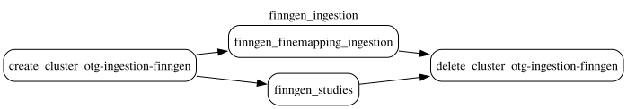

# FinnGen GWAS

This document was updated on 2026-10-29.

```sh
gs://finngen_data/gwas/prod/20260526T131014/config/finngen_ingestion.yaml # DAG config of the run
gs://finngen_data/gwas/prod/20260526T131014/docs/
gs://finngen_data/gwas/prod/20260526T131014/output/study_index/
gs://finngen_data/gwas/prod/20260526T131014/output/credible_set_datasets/susie/
```

Data contained in `gwas` corresponds to the SuSiE fine-mapping results of [FinnGen Data Freeze 12](https://r12.finngen.fi/) (November 4 2024), published by FinnGen in `gs://finngen-public-data-r12/`.

Data is produced by **finngen_ingestion DAG**. The DAG configuration and topology are in `config/finngen_ingestion.yaml` of the run folder (`gs://finngen_data/gwas/prod/20260526T131014/config/`). The run uses gentropy [`v3.2.0`](https://github.com/opentargets/gentropy/tree/v3.2.0) (`GENTROPY_REF`); the links below refer to that tag.

The run folder is named after the write time of the first output of the run, the `study_index` part file (2026-05-26 13:10:14 UTC). The run outputs were written to `gs://finngen_data/r12/` and moved to the run folder on 2026-10-29.

Inputs of the run:

```sh
gs://finngen-public-data-r12/finemap/full/susie/*.snp.bgz
gs://finngen-public-data-r12/finemap/summary/*SUSIE.cred.summary.tsv
https://r12.finngen.fi/api/phenos
https://raw.githubusercontent.com/opentargets/curation/refs/tags/26.05/mappings/disease/manual_string.tsv
```

The `*.snp.bgz` files hold the SuSiE results per variant, one file per phenotype. The `*SUSIE.cred.summary.tsv` files hold the summary of each credible set: its log10 Bayes factor and purity. The FinnGen phenotype API lists the phenotypes with their case and control counts. The `manual_string.tsv` file of the Open Targets curation repository, at tag `26.05`, maps FinnGen phenotypes to ontology terms.

The DAG has 2 steps, run in parallel on one Dataproc cluster:



1. finngen_studies
2. finngen_finemapping_ingestion

## finngen_studies

The step ([`finngen_studies.py`](https://github.com/opentargets/gentropy/blob/v3.2.0/src/gentropy/finngen_studies.py)) builds one study per phenotype of the FinnGen phenotype API ([`study_index.py`](https://github.com/opentargets/gentropy/blob/v3.2.0/src/gentropy/datasource/finngen/study_index.py)). The study identifier is the phenotype code prefixed with `FINNGEN_R12_`. The ontology terms of a study are the curation rows whose `STUDY` contains `FINNGEN` and `R12` and whose `PROPERTY_VALUE` equals the phenotype name ([`efo_mapping.py`](https://github.com/opentargets/gentropy/blob/v3.2.0/src/gentropy/datasource/finngen/efo_mapping.py)). A study with no matching curation row keeps an empty list of ontology terms. The output is `output/study_index/`: 2,470 studies, 29 of them without ontology terms.

## finngen_finemapping_ingestion

The step ([`finngen_finemapping_ingestion.py`](https://github.com/opentargets/gentropy/blob/v3.2.0/src/gentropy/finngen_finemapping_ingestion.py)) builds one credible set per FinnGen SuSiE credible set ([`finemapping.py`](https://github.com/opentargets/gentropy/blob/v3.2.0/src/gentropy/datasource/finngen/finemapping.py)):

- The variants of a credible set are the variants of the `*.snp.bgz` files assigned to it (`cs` > 0).
- A credible set is kept when it is the first credible set of its region, or when its log10 Bayes factor is above 0.8686 (log10(e²), the threshold of the FinnGen publication).
- The lead variant of a credible set is its variant with the highest posterior probability.
- A credible set whose lead has a p-value above 1e-5 is flagged `Subsignificant p-value`.
- Within `locus`, variants are sorted by posterior probability, and `is95CredibleSet` and `is99CredibleSet` mark the variants needed to reach a cumulative posterior probability of 0.95 and 0.99 ([`study_locus.py`](https://github.com/opentargets/gentropy/blob/v3.2.0/src/gentropy/dataset/study_locus.py)).

The output is `output/credible_set_datasets/susie/`: 22,133 credible sets from 1,302 studies, 676 of them flagged `Subsignificant p-value`. Every study of the credible sets is in `study_index`.

## Outputs

### study_index

One row per FinnGen phenotype.

| Column | Type | Description |
|---|---|---|
| `traitFromSource` | `string` | Phenotype name, as in the FinnGen phenotype API. |
| `studyId` | `string` | `FINNGEN_R12_<phenocode>`. |
| `nCases` | `integer` | Number of cases. |
| `nControls` | `integer` | Number of controls. |
| `nSamples` | `integer` | `nCases` + `nControls`. |
| `discoverySamples` | `array<struct<sampleSize: integer, ancestry: string>>` | One sample: the size of the release (500,348) and the ancestry `Finnish`. |
| `cohorts` | `array<string>` | `[FinnGen]`. |
| `summarystatsLocation` | `string` | Summary statistics of the phenotype, `gs://finngen-public-data-r12/summary_stats/finngen_R12_<phenocode>.gz`. |
| `projectId` | `string` | `FINNGEN_R12`. |
| `studyType` | `string` | `gwas`. |
| `hasSumstats` | `boolean` | `true`. |
| `initialSampleSize` | `string` | `500,348 (282,064 females and 218,284 males)`. |
| `pubmedId` | `string` | `36653562`, the FinnGen publication. |
| `ldPopulationStructure` | `array<struct<ldPopulation: string, relativeSampleSize: double>>` | `fin` with a relative sample size of 1.0. |
| `traitFromSourceMappedIds` | `array<string>` | Ontology terms of the phenotype, from the curation file. Empty for 29 studies. |

### credible_set_datasets/susie

One row per credible set.

| Column | Type | Description |
|---|---|---|
| `studyId` | `string` | Study of the credible set, as in `study_index`. |
| `region` | `string` | Fine-mapped region, `chr<chromosome>:<start>-<end>`. Chromosome X is `chrX`, except in 87 credible sets of `FINNGEN_R12_HEIGHT_IRN`, which FinnGen labels `chr23`. |
| `credibleSetIndex` | `integer` | Index of the credible set within the region, 1 to 10. |
| `locus` | `array<struct<variantId: string, posteriorProbability: double, logBF: double, pValueMantissa: float, pValueExponent: integer, beta: double, standardError: double, is95CredibleSet: boolean, is99CredibleSet: boolean>>` | Variants of the credible set, sorted by `posteriorProbability`, with their log Bayes factor (`logBF`), p-value, posterior mean effect (`beta`) and standard error. |
| `variantId` | `string` | Lead variant, `<chromosome>_<position>_<ref>_<alt>` on GRCh38. |
| `chromosome` | `string` | Chromosome of the lead variant. |
| `position` | `integer` | Position of the lead variant on GRCh38. |
| `beta` | `double` | Posterior mean effect of the lead in the credible set. |
| `pValueMantissa` | `float` | Mantissa of the p-value of the lead (p = mantissa × 10^exponent). |
| `pValueExponent` | `integer` | Exponent of the p-value of the lead. |
| `effectAlleleFrequencyFromSource` | `float` | Minor allele frequency of the lead (`maf` of the source), at most 0.5. |
| `standardError` | `double` | Standard error of the lead. |
| `finemappingMethod` | `string` | `SuSie`. |
| `credibleSetlog10BF` | `double` | Log10 Bayes factor of the credible set. Null for 31 credible sets. |
| `purityMeanR2` | `double` | Mean r² between the variants of the credible set. |
| `purityMinR2` | `double` | Minimum r² between the variants of the credible set. |
| `locusStart` | `integer` | Start of `region`. |
| `locusEnd` | `integer` | End of `region`. |
| `studyLocusId` | `string` | Identifier of the credible set: a hash of `studyId`, `variantId` and `finemappingMethod`. |
| `qualityControls` | `array<string>` | `Subsignificant p-value` for a lead with a p-value above 1e-5, otherwise empty. |
