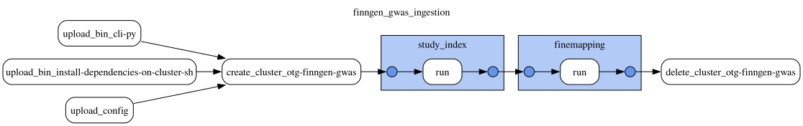

# FinnGen GWAS

This document was updated on 2026-10-31.

```sh
gs://finngen_data/gwas/prod/20261029T152531/bin/                               # gentropy CLI and cluster init script of the run
gs://finngen_data/gwas/prod/20261029T152531/config/finngen_gwas_ingestion.yaml # DAG config of the run
gs://finngen_data/gwas/prod/20261029T152531/docs/
gs://finngen_data/gwas/prod/20261029T152531/output/study/
gs://finngen_data/gwas/prod/20261029T152531/output/credible_set/
gs://finngen_data/gwas/prod/20261029T152531/output/credible_set_variant/
```

Data contained in `gwas` corresponds to the SuSiE fine-mapping results of [FinnGen Data Freeze 12](https://r12.finngen.fi/) (November 4 2024), published by FinnGen in `gs://finngen-public-data-r12/`.

Data is produced by **finngen_gwas_ingestion DAG**. The DAG configuration and topology are in `config/finngen_gwas_ingestion.yaml` of the run folder (`gs://finngen_data/gwas/prod/20261029T152531/config/`). The run of 2026-10-31 uses gentropy [`v4.0.0-dev.11`](https://github.com/opentargets/gentropy/tree/v4.0.0-dev.11); the links below refer to that tag. The gentropy CLI (`cli.py`) and the cluster init script (`install_dependencies_on_cluster.sh`) of the tag are copied to `bin/` of the run folder.

Inputs of the run:

```sh
gs://finngen-public-data-r12/finemap/full/susie/*.snp.bgz
gs://finngen-public-data-r12/finemap/summary/*SUSIE.cred.summary.tsv
gs://finngen-public-data-r12/annotations/finnge_R12_annotated_variants_v1.gz
https://r12.finngen.fi/api/phenos
https://raw.githubusercontent.com/opentargets/curation/refs/tags/26.09.2/mappings/disease/manual_string.tsv
```

The `*.snp.bgz` files hold every variant of each fine-mapped region of a phenotype, with its marginal statistics and the SuSiE statistics of each of the 10 single effects. The `*SUSIE.cred.summary.tsv` files hold the summary of each credible set: its log10 Bayes factor and purity. The annotated variants file (block gzipped, 30 GiB) holds the allele frequencies of the FinnGen R12 variants. The FinnGen phenotype API lists the phenotypes with their case and control counts. The `manual_string.tsv` file of the Open Targets curation repository, at tag `26.09.2`, maps FinnGen phenotypes to ontology terms.

The DAG has 2 steps, run one after another on one Dataproc cluster:



1. study_index
2. finemapping

## Outputs

| Output | Rows | Files |
|---|---|---|
| `study` | 2,470 | 1 |
| `credible_set` | 21,457 | 1 |
| `credible_set_variant` | 1,100,722 | 1 |

### study

One row per FinnGen phenotype.

| Column | Type | Description |
|---|---|---|
| `traitFromSource` | `string` | Phenotype name, as in the FinnGen phenotype API. |
| `studyId` | `string` | `FINNGEN_R12_<phenocode>`. |
| `nCases` | `integer` | Number of cases. |
| `nControls` | `integer` | Number of controls. |
| `nSamples` | `integer` | `nCases` + `nControls`. |
| `discoverySamples` | `array<struct<sampleSize: integer, ancestry: string>>` | One sample: the size of the release (500,348) and the ancestry `Finnish`. |
| `cohorts` | `array<string>` | `[FinnGen]`. |
| `summarystatsLocation` | `string` | Summary statistics of the phenotype, `gs://finngen-public-data-r12/summary_stats/finngen_R12_<phenocode>.gz`. |
| `projectId` | `string` | `FINNGEN_R12`. |
| `studyType` | `string` | `gwas`. |
| `hasSumstats` | `boolean` | `true`. |
| `initialSampleSize` | `string` | `500,348 (282,064 females and 218,284 males)`. |
| `pubmedId` | `string` | `36653562`, the FinnGen publication. |
| `ldPopulationStructure` | `array<struct<ldPopulation: string, relativeSampleSize: double>>` | `fin` with a relative sample size of 1.0. |
| `traitFromSourceMappedIds` | `array<string>` | Ontology terms of the phenotype, from the curation file. Empty for 29 studies. |

### credible_set

One row per credible set.

| Column | Type | Description |
|---|---|---|
| `id` | `string` | Identifier of the credible set: the md5 hash of `studyId`, `chromosome`, `locusStart`, `locusEnd`, `leadVariantId` and `fineMappingMethod`. |
| `chromosome` | `string` | Chromosome of the lead variant; `X` for chromosome X. |
| `locusStart` | `integer` | Start of the fine-mapped region, from `region` of the source. |
| `locusEnd` | `integer` | End of the fine-mapped region, from `region` of the source. |
| `studyId` | `string` | Study of the credible set, as in `study`. |
| `studyType` | `string` | `gwas`. |
| `leadVariantId` | `string` | Lead variant, `<chromosome>_<position>_<ref>_<alt>` on GRCh38. |
| `fineMappingMethod` | `string` | `SuSiE`. |
| `logBayesFactor` | `double` | Natural log Bayes factor of the single effect over every variant of the region. |
| `confidence` | `tinyint` | Empty. |
| `purityMeanR2` | `double` | Mean r² between the variants of the credible set (`cs_avg_r2`). |
| `purityMinR2` | `double` | Minimum r² between the variants of the credible set (`cs_min_r2`). |
| `qualityControls` | `array<string>` | Empty for every credible set. |

### credible_set_variant

One row per variant of a credible set. The posterior probabilities of the variants of a credible set sum to at least 0.95.

| Column | Type | Description |
|---|---|---|
| `credibleSetId` | `string` | Credible set of the variant, as `id` in `credible_set`. |
| `variantId` | `string` | Variant, `<chromosome>_<position>_<ref>_<alt>` on GRCh38. |
| `pValueMantissa` | `float` | Mantissa of the marginal p-value (p = mantissa × 10^exponent). |
| `pValueExponent` | `integer` | Exponent of the marginal p-value. |
| `effectAlleleFrequency` | `float` | Frequency of the alternative allele, `AF` of the annotated variants file. Null for 34,116 variants missing from the file. |
| `sampleSize` | `integer` | Empty: the source gives no per-variant sample size. |
| `reportedBeta` | `double` | Marginal effect of the alternative allele (`beta`). |
| `reportedStandardError` | `double` | Standard error of `reportedBeta` (`se`). |
| `posteriorProbability` | `float` | Posterior inclusion probability of the variant in the single effect of the credible set (`alpha<cs>`). |
| `logBayesFactor` | `float` | Natural log Bayes factor of the variant in the single effect (`lbf_variable<cs>`). |
| `r2Overall` | `float` | In-sample r² with FinnGen's lead of the credible set (`lead_r2`). FinnGen's lead is the variant with the highest overall posterior inclusion probability (`prob`); it is the lead of `credible_set` in 21,250 credible sets, and the lead's `r2Overall` is below 1 in the other 207. |
| `conditionalBeta` | `float` | Posterior mean effect given that the variant is causal, `mean<cs> / alpha<cs>`. FinnGen writes `mean<l>` as `alpha·mu / scale` ([`run_susieR.R`](https://github.com/FINNGEN/finemapping-pipeline/blob/master/R/run_susieR.R)), so the ratio is `mu / scale`, the effect per allele. |
| `conditionalStandardError` | `float` | Posterior standard deviation of the effect given that the variant is causal, `sqrt((sd<cs>² + mean<cs>²) / alpha<cs> − conditionalBeta²)`. FinnGen writes `sd<l>` as `sqrt(alpha·mu2 − (alpha·mu)²) / scale`, so this is `sqrt(mu2 − mu²) / scale`. |
| `rescaledAbsBeta` | `float` | Empty. |
| `rescaledStandardError` | `float` | Empty. |
| `rescaledDirection` | `tinyint` | Empty. |
| `qualityControls` | `array<string>` | `Allele frequency reported by the study` when `effectAlleleFrequency` is set, otherwise empty. |

## Changelog

### 2025-02-05

- [fix: updating info in finngen study index ingestion (#972)](https://github.com/opentargets/gentropy/pull/972)

### 2025-04-11

- chore: removal of r11 and r10 data to prevent data duplication.

### 2025-07-24

- [feat: updated finngen studyIndex to contain pubmedId upon ingestion](https://github.com/opentargets/issues/issues/3946)

### 2026-05-20

- [feat: rerun study index generation to include latest EFO changes](https://github.com/opentargets/issues/issues/4344)

### 2026-10-29

- chore: move the FinnGen GWAS release (run of 2026-05-26) from `gs://finngen_data/r12/` to `gs://finngen_data/gwas/prod/20260526T131014/` (`config/`, `docs/`, `output/`), and split its docs into this README.
- chore: remove the top-level `gs://finngen_data/docs/`; the docs of each run are under `docs/` of its run folder.
- chore: remove `gs://finngen_data/100_3mb_carma/`, CARMA fine-mapping outputs that no DAG produces or reads.

### 2026-10-31

- feat: replace the `finngen_ingestion` DAG with `finngen_gwas_ingestion`, a StagingDagConfig DAG on gentropy `v4.0.0-dev.11` writing the `study`, `credible_set` and `credible_set_variant` datasets to `gs://finngen_data/gwas/prod/<YYYYMMDDTHHMMSS>/`. Its first run, `gs://finngen_data/gwas/prod/20261029T152531/`, differs from the frozen release:
  - credible sets whose lead has a p-value above 1e-5 are dropped (676 credible sets of the frozen release, flagged `Subsignificant p-value` there): 21,457 credible sets, with the same lead and region as in the frozen release;
  - `effectAlleleFrequency` is the alternative allele frequency `AF` of the FinnGen annotated variants file, where the frozen release had the minor allele frequency `maf`;
  - the EFO mappings come from curation tag `26.09.2` (`26.05` in the frozen release): 1,314 studies are mapped to different terms, e.g. EFO terms replaced by MONDO terms.
- docs: remove the `finngen_data/README.md` bucket index; each FinnGen source keeps its own README, with its changelog.
