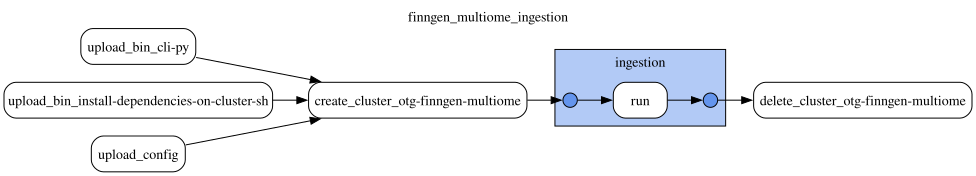

# FinnGen multiome

This document was updated on 2026-10-31.

```sh
gs://finngen_data/multiome/prod/20261029T125742/bin/                                   # gentropy CLI and cluster init script of the run
gs://finngen_data/multiome/prod/20261029T125742/config/finngen_multiome_ingestion.yaml # DAG config of the run
gs://finngen_data/multiome/prod/20261029T125742/docs/
gs://finngen_data/multiome/prod/20261029T125742/output/study/
gs://finngen_data/multiome/prod/20261029T125742/output/credible_set/
gs://finngen_data/multiome/prod/20261029T125742/output/credible_set_variant/
```

Data contained in `multiome` corresponds to the single-cell cis-eQTL SuSiE fine-mapping of the [FinnGen immune multiome atlas](https://www.nature.com/articles/s41586-026-11078-2) (release 1, on FinnGen R12 donors), published by FinnGen in `gs://finngen-public-data-multiome/eQTL/`.

Data is produced by **finngen_multiome_ingestion DAG**. The DAG configuration and topology are in `config/finngen_multiome_ingestion.yaml` of the run folder (`gs://finngen_data/multiome/prod/20261029T125742/config/`). The run uses gentropy [`v4.0.0-dev.5`](https://github.com/opentargets/gentropy/tree/v4.0.0-dev.5); the links below refer to that tag. The gentropy CLI (`cli.py`) and the cluster init script (`install_dependencies_on_cluster.sh`) of the tag are copied to `bin/` of the run folder.

Inputs of the run:

```sh
gs://finngen-public-data-multiome/eQTL/finemapping/*.SUSIE.snp.tsv.gz
gs://finngen-public-data-multiome/eQTL/finemapping/*.SUSIE.cred.tsv.gz
gs://finngen-public-data-multiome/eQTL/cis_nominal/*.cis_nominal.tsv.gz
```

Each input is split per cell type, and the fine-mapping files also per chromosome: `finngen_multiome_v1.eQTL.<cell type>.<chromosome>.SUSIE.{snp,cred}.tsv.gz` and `finngen_multiome_v1.eQTL.<cell type>.cis_nominal.tsv.gz`. A cell type is an [Azimuth](https://azimuth.hubmapconsortium.org/) annotation of level 1 (`l1.*`, including all PBMCs together as `l1.PBMC`) or level 2 (`l2.*`), 33 cell types in total. The `*.SUSIE.snp.tsv.gz` files hold every variant tested for a gene, with its marginal statistics and the SuSiE results of each of the 10 single effects. The `*.SUSIE.cred.tsv.gz` files hold the summary of each 95% credible set: its log10 Bayes factor and purity. The `*.cis_nominal.tsv.gz` files hold the marginal statistics of every variant and gene; the step reads only the alternative allele frequency (`AF_Allele2`) from them.

The DAG has 1 step, run on one Dataproc cluster:



1. ingestion

## ingestion

The step ([`finngen_multiome_ingestion.py`](https://github.com/opentargets/gentropy/blob/v4.0.0-dev.5/src/gentropy/finngen_multiome_ingestion.py)) runs with the defaults of `FinngenMultiomeIngestionConfig` ([`config.py`](https://github.com/opentargets/gentropy/blob/v4.0.0-dev.5/src/gentropy/config.py)) for every parameter other than the input and output paths: project prefix `FINNGEN_MULTIOME_V1`, lead p-value threshold 1e-3, log10 Bayes factor threshold 0.8686 (log10(e²), the threshold of the FinnGen publication) and minimum purity r² 0.25.

A credible set of the `*.SUSIE.cred.tsv.gz` files is kept when it is the first credible set of its gene or its log10 Bayes factor is above 0.8686, and when its minimum r² between variants (`cs_min_r2`) is at least 0.25, the cut-off of FinnGen's `low_purity` flag ([`finemapping.py`](https://github.com/opentargets/gentropy/blob/v4.0.0-dev.5/src/gentropy/datasource/finngen_multiome/finemapping.py)).

The study index ([`study_index.py`](https://github.com/opentargets/gentropy/blob/v4.0.0-dev.5/src/gentropy/datasource/finngen_multiome/study_index.py)) holds one study per cell type and gene with at least one kept credible set. The study identifier is `FINNGEN_MULTIOME_V1_ge_<cell type>_<gene>`, with the `.` of the cell type replaced by `_`, e.g. `FINNGEN_MULTIOME_V1_ge_l2_CD4_Naive_ENSG00000015475`. The Cell Ontology term and the number of donors of each cell type are fixed in `FinnGenMultiomeStudyIndex.CELL_TYPES`; the donors are those of Supplementary Table 12 of the publication.

The credible sets and their variants are built from the variants of the `*.SUSIE.snp.tsv.gz` files assigned to a kept credible set (`cs` > 0) ([`credible_set.py`](https://github.com/opentargets/gentropy/blob/v4.0.0-dev.5/src/gentropy/dataset/credible_set.py)):

- The lead variant of a credible set is its variant with the highest posterior probability, ties broken by `variantId`.
- A credible set whose lead has a p-value above 1e-3 is dropped with its variants.
- The locus of a credible set spans the first to the last variant tested for its gene.
- The log Bayes factor of a credible set (`logBayesFactor`) is the natural log Bayes factor of its single effect over every variant tested for the gene, with a uniform prior over those variants ([`stats.py`](https://github.com/opentargets/gentropy/blob/v4.0.0-dev.5/src/gentropy/common/stats.py)). The `cs_log10bf` of the source is used only to filter the credible sets.

The run gives 120,517 studies over 16,082 genes and 32 cell types, 170,013 credible sets from 120,512 studies, and 6,290,923 credible set variants. The `l2.NK_Proliferating` cell type has no studies: its `*.SUSIE.cred.tsv.gz` files are empty. 5 studies have no credible set, as their credible sets were dropped by the lead p-value threshold after the study index was built. Every study of the credible sets is in `study`, and every lead variant is in `credible_set_variant`.

## Outputs

### study

One row per cell type and gene.

| Column | Type | Description |
|---|---|---|
| `studyId` | `string` | `FINNGEN_MULTIOME_V1_ge_<cell type>_<gene>`. |
| `projectId` | `string` | `FINNGEN_MULTIOME_V1`. |
| `geneId` | `string` | Ensembl gene identifier of the eQTL. |
| `traitFromSource` | `string` | Same as `geneId`. |
| `biosampleFromSourceId` | `string` | Cell Ontology term of the cell type. |
| `nSamples` | `integer` | Number of donors of the cell type, 175 to 1,103. |
| `initialSampleSize` | `string` | `<nSamples> Finnish individuals`. |
| `discoverySamples` | `array<struct<sampleSize: integer, ancestry: string>>` | One sample: `nSamples` and the ancestry `Finnish`. |
| `cohorts` | `array<string>` | `[FinnGen]`. |
| `summarystatsLocation` | `string` | cis-nominal summary statistics of the cell type, `gs://finngen-public-data-multiome/eQTL/cis_nominal/finngen_multiome_v1.eQTL.<cell type>.cis_nominal.tsv.gz`. |
| `studyType` | `string` | `sceqtl`. |
| `condition` | `string` | `naive`. |
| `hasSumstats` | `boolean` | `true`. |
| `publicationTitle` | `string` | `Population-scale immune multiome atlas reveals regulatory disease mechanisms`. |
| `publicationJournal` | `string` | `Nature`. |
| `publicationFirstAuthor` | `string` | `Kanai M`. |
| `publicationDate` | `string` | `2026-09-30`. |
| `pubmedId` | `string` | `42816628`. |
| `ldPopulationStructure` | `array<struct<ldPopulation: string, relativeSampleSize: double>>` | `fin` with a relative sample size of 1.0. |

### credible_set

One row per credible set.

| Column | Type | Description |
|---|---|---|
| `id` | `string` | Identifier of the credible set: a hash of `studyId`, `chromosome`, `locusStart`, `locusEnd`, `leadVariantId` and `fineMappingMethod`. |
| `chromosome` | `string` | Chromosome of the gene. |
| `locusStart` | `integer` | Position of the first variant tested for the gene. |
| `locusEnd` | `integer` | Position of the last variant tested for the gene. |
| `studyId` | `string` | Study of the credible set, as in `study`. |
| `studyType` | `string` | `sceqtl`. |
| `leadVariantId` | `string` | Lead variant, `<chromosome>_<position>_<ref>_<alt>` on GRCh38. |
| `fineMappingMethod` | `string` | `SuSiE`. |
| `logBayesFactor` | `double` | Natural log Bayes factor of the single effect over every variant tested for the gene. |
| `confidence` | `tinyint` | Empty. |
| `purityMeanR2` | `double` | Mean r² between the variants of the credible set (`cs_avg_r2`). |
| `purityMinR2` | `double` | Minimum r² between the variants of the credible set (`cs_min_r2`), at least 0.25. |
| `qualityControls` | `array<string>` | Empty. |

### credible_set_variant

One row per variant of a credible set.

| Column | Type | Description |
|---|---|---|
| `credibleSetId` | `string` | Credible set of the variant, `id` of `credible_set`. |
| `variantId` | `string` | Variant, `<chromosome>_<position>_<ref>_<alt>` on GRCh38. |
| `pValueMantissa` | `float` | Mantissa of the marginal p-value (p = mantissa × 10^exponent). |
| `pValueExponent` | `integer` | Exponent of the marginal p-value. |
| `effectAlleleFrequency` | `float` | Frequency of the alternative allele, `AF_Allele2` of the cis-nominal file of the cell type. |
| `sampleSize` | `integer` | Empty. |
| `reportedBeta` | `double` | Marginal effect of the alternative allele (`beta`). |
| `reportedStandardError` | `double` | Standard error of `reportedBeta` (`se`). |
| `posteriorProbability` | `float` | Posterior inclusion probability of the variant in the single effect of the credible set (`alpha<cs>`). |
| `logBayesFactor` | `float` | Natural log Bayes factor of the variant in the single effect (`lbf_variable<cs>`). |
| `r2Overall` | `float` | `lead_r2` of the source. |
| `conditionalBeta` | `float` | Posterior mean effect given that the variant is causal, `mean<cs> / alpha<cs>`. |
| `conditionalStandardError` | `float` | Posterior standard deviation of the effect given that the variant is causal, `sqrt((sd<cs>² + mean<cs>²) / alpha<cs> − conditionalBeta²)`. |
| `rescaledAbsBeta` | `float` | Empty. |
| `rescaledStandardError` | `float` | Empty. |
| `rescaledDirection` | `tinyint` | Empty. |
| `qualityControls` | `array<string>` | `Allele frequency reported by the study`. |

## Changelog

### 2026-10-29

- feat: add the `finngen_multiome_ingestion` DAG, a StagingDagConfig DAG on gentropy `v4.0.0-dev.5` writing to `gs://finngen_data/multiome/prod/<YYYYMMDDTHHMMSS>/`.
- docs: add this README, uploaded to `docs/` of the run folder `gs://finngen_data/multiome/prod/20261029T125742/`.

### 2026-10-31

- docs: remove the `finngen_data/README.md` bucket index; each FinnGen source keeps its own README, with its changelog.
