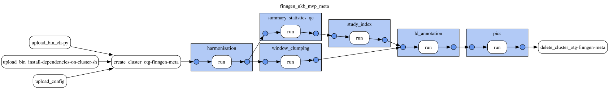

# FinnGen, UK Biobank and MVP meta-analysis

This document was updated on 2026-11-02.

```sh
gs://finngen_data/meta/three-way/prod/20261102T181409/bin/                             # gentropy CLI and cluster init script of the run
gs://finngen_data/meta/three-way/prod/20261102T181409/config/finngen_ukb_mvp_meta.yaml # DAG config of the run
gs://finngen_data/meta/three-way/prod/20261102T181409/docs/
gs://finngen_data/meta/three-way/prod/20261102T181409/output/harmonised_summary_statistics/
gs://finngen_data/meta/three-way/prod/20261102T181409/output/harmonised_summary_statistics_qc/
gs://finngen_data/meta/three-way/prod/20261102T181409/output/study/
gs://finngen_data/meta/three-way/prod/20261102T181409/output/study_locus/
gs://finngen_data/meta/three-way/prod/20261102T181409/output/ld_annotated_study_locus/
gs://finngen_data/meta/three-way/prod/20261102T181409/output/credible_set/
gs://finngen_data/meta/three-way/prod/20261102T181409/output/credible_set_variant/
```

Data contained in `meta/three-way` corresponds to the three-way meta-analysis of [FinnGen R12, the Million Veteran Program (MVP) and the Pan-UK Biobank](https://mvp-ukbb.finngen.fi/about), published by FinnGen in `gs://finngen-public-data-r12/meta_analysis/mvp_ukbb/`. The meta-analysis covers 330 phenotypes. The processing is described in [opentargets/issues#3474](https://github.com/opentargets/issues/issues/3474).

Data is produced by **finngen_ukb_mvp_meta DAG**. The DAG configuration and topology are in `config/finngen_ukb_mvp_meta.yaml` of the run folder (`gs://finngen_data/meta/three-way/prod/20261102T181409/config/`). The gentropy CLI (`cli.py`) and the cluster init script (`install_dependencies_on_cluster.sh`) of the gentropy tag are copied to `bin/` of the run folder. The run folder is named after the time its DAG config was written, 2026-11-02 18:14:09 UTC.

The harmonisation, summary_statistics_qc and window_clumping steps ran on gentropy [`v4.0.0-dev.12`](https://github.com/opentargets/gentropy/tree/v4.0.0-dev.12), and the study_index, ld_annotation and pics steps on [`v4.0.0-dev.13`](https://github.com/opentargets/gentropy/tree/v4.0.0-dev.13), which starts the study index with an empty `qualityControls`. Between the two tags only the study index changes, so the links below refer to `v4.0.0-dev.13`. `config/` holds the DAG config on `v4.0.0-dev.13`.

Inputs of the run:

```sh
gs://finngen-public-data-r12/meta_analysis/mvp_ukbb/FinnGen_R12_MVP_UKBB_manifest.tsv
gs://finngen-public-data-r12/meta_analysis/mvp_ukbb/summary_stats/*_meta_out.tsv.gz
https://raw.githubusercontent.com/opentargets/curation/refs/tags/26.09.2/mappings/disease/manual_string.tsv
gs://gnomad_data_2/v4.1/variant_index/
gs://gnomad_data_2/v2.1.1/ld_index/
```

The manifest lists the 330 phenotypes with their case and control counts per cohort, and the location of the summary statistics of each phenotype in its `path_bucket` column. The summary statistics are block gzipped TSV files; the 330 files have 6 distinct headers, which differ in the cohorts present. The `manual_string.tsv` file of the Open Targets curation repository, at tag `26.09.2`, maps FinnGen phenotypes to ontology terms. The gnomAD v4.1 variant index is the reference for allele orientation, and the gnomAD v2.1.1 LD index is the LD reference of the LD annotation.

The DAG has 6 steps on one Dataproc cluster. The harmonisation runs first and alone; summary_statistics_qc and window_clumping run in parallel after it, and ld_annotation starts when both window_clumping and study_index end:



1. harmonisation
2. summary_statistics_qc
3. study_index
4. window_clumping
5. ld_annotation
6. pics

## Outputs

| Output | Rows | Files |
|---|---|---|
| `harmonised_summary_statistics` | 3,856,869,857 | 7,570 |
| `harmonised_summary_statistics_qc` | 330 | 1 |
| `study` | 330 | 1 |
| `study_locus` | 15,944 | 100 |
| `ld_annotated_study_locus` | 15,944 | 64 |
| `credible_set` | 15,578 | 20 |
| `credible_set_variant` | 615,261 | 20 |

## harmonisation

In this step ([`finngen_ukb_mvp_meta.py`](https://github.com/opentargets/gentropy/blob/v4.0.0-dev.13/src/gentropy/finngen_ukb_mvp_meta.py)), the summary statistics listed in the manifest are read ([`summary_statistics.py`](https://github.com/opentargets/gentropy/blob/v4.0.0-dev.13/src/gentropy/datasource/finngen_meta/summary_statistics.py)). The header of each file is read first, and the files with the same header are read together, so the 330 files are read in 6 reads. Only the columns used by the harmonisation are kept; `NA` is read as null, and the columns of a cohort missing from a file are null.

The harmonised summary statistics are built from the source summary statistics:

- The effect is the inverse-variance meta-analysis effect over all cohorts (`all_inv_var_meta_beta`, `all_inv_var_meta_sebeta`, `all_inv_var_meta_mlogp`). Variants without these values are removed.
- A variant is kept when it is present in at least two of the three biobanks (FinnGen, MVP, UK Biobank).
- A variant is removed when its imputation score (`r2`) is below 0.8 in any MVP cohort. A missing score passes the filter.
- A variant found in the gnomAD v4.1 variant index takes the gnomAD allele orientation; the effect and the allele frequencies are flipped when the alleles are swapped. A variant not found in gnomAD keeps the source orientation.
- The effect allele frequency is the sample-size-weighted mean of the cohort allele frequencies.
- A variant is removed when its minor allele count is below 20 in any cohort.

The output is `output/harmonised_summary_statistics/`, partitioned by `studyId` and `chromosome`, with one file per study and chromosome and the variants sorted by `position`. No raw copy of the source summary statistics is written.

## summary_statistics_qc

The step ([`sumstat_qc_step.py`](https://github.com/opentargets/gentropy/blob/v4.0.0-dev.13/src/gentropy/sumstat_qc_step.py)) computes the QC metrics of the harmonised summary statistics of each study ([`summary_statistics_qc.py`](https://github.com/opentargets/gentropy/blob/v4.0.0-dev.13/src/gentropy/dataset/summary_statistics_qc.py)), with a p-value threshold of 1e-8 for `n_variants_sig`. The output is `output/harmonised_summary_statistics_qc/`: one row per study.

## study_index

The step ([`finngen_ukb_mvp_meta.py`](https://github.com/opentargets/gentropy/blob/v4.0.0-dev.13/src/gentropy/finngen_ukb_mvp_meta.py), [`study_index.py`](https://github.com/opentargets/gentropy/blob/v4.0.0-dev.13/src/gentropy/datasource/finngen_meta/study_index.py)) builds one study per manifest row. The study identifier is the FinnGen phenotype code prefixed with `FINNGEN_R12_UKB_MVP_META_`. The ontology terms of a study come from the curation rows of FinnGen R12 whose phenotype name matches the study. The studies are annotated with the QC metrics of `harmonised_summary_statistics_qc` in `sumstatQCValues`, and with a QC flag in `qualityControls` for each metric outside its threshold. The `qualityControls` of every study are empty. The output is `output/study/`: 330 studies.

## window_clumping

The step ([`window_based_clumping.py`](https://github.com/opentargets/gentropy/blob/v4.0.0-dev.13/src/gentropy/window_based_clumping.py), [`window.py`](https://github.com/opentargets/gentropy/blob/v4.0.0-dev.13/src/gentropy/method/clumping/window.py)) selects the lead variants of the harmonised summary statistics: per study and chromosome, the variants with a p-value of at most 1e-8, ranked by p-value, with every lead at least 500 kb from a more significant lead. Each lead gets a locus from 500 kb before to 500 kb after it, and `locus` holds the harmonised summary statistics of the study inside the locus. The output is `output/study_locus/`: 15,944 loci from 269 studies, with 71,285,885 variants in `locus` (from 17 to 19,544 per locus, 4,086 at the median).

## ld_annotation

The step ([`ld_based_clumping.py`](https://github.com/opentargets/gentropy/blob/v4.0.0-dev.13/src/gentropy/ld_based_clumping.py), [`annotation.py`](https://github.com/opentargets/gentropy/blob/v4.0.0-dev.13/src/gentropy/method/annotation.py), [`ld.py`](https://github.com/opentargets/gentropy/blob/v4.0.0-dev.13/src/gentropy/method/clumping/ld.py)) annotates each locus with the variants in LD with its lead from the gnomAD v2.1.1 LD index, in `ldSet`. A variant is kept when its r² with the lead is at least 0.5 in the major population of the study, the population with the largest `relativeSampleSize` in `ldPopulationStructure` (`nfe` for 317 studies and `fin` for 13 studies). A lead without such a variant is flagged `Variant not found in LD reference` (736 loci), and its `ldSet` holds the lead only. A lead in LD with a more significant lead of the same study is flagged `Explained by a more significant variant in high LD` (366 loci), and its `ldSet` is emptied. The output is `output/ld_annotated_study_locus/`: 15,944 loci.

## pics

The step ([`pics.py`](https://github.com/opentargets/gentropy/blob/v4.0.0-dev.13/src/gentropy/pics.py), [`pics.py`](https://github.com/opentargets/gentropy/blob/v4.0.0-dev.13/src/gentropy/method/fine_mapping/pics.py)) fine-maps each LD-annotated locus with [PICS](https://opentargets.github.io/gentropy/python_api/methods/pics/), from the p-value of its lead and its `ldSet`. The 366 loci explained by a more significant lead, whose `ldSet` is empty, are not fine-mapped. The members of a credible set are the variants of `ldSet`, sorted by posterior probability, up to the variant that brings the sum of the posterior probabilities to 0.95; the posterior probabilities are not rescaled after the cut. The outputs are `output/credible_set/`, 15,578 credible sets from 269 studies, and `output/credible_set_variant/`, 615,261 members (from 1 to 3,091 per credible set, 15 at the median). Every study of the credible sets is in `study`.

## Output schemas

### harmonised_summary_statistics

One row per variant and study. `studyId` and `chromosome` are the partition columns: their values are in the directory names, `studyId=<studyId>/chromosome=<chromosome>/`. Partition discovery is required to read them, for example `step.recursive_file_lookup=false` in `window_based_clumping`.

| Column | Type | Description |
|---|---|---|
| `studyId` | `string` | Study, as in `study`. Partition column. |
| `chromosome` | `string` | Chromosome, `1` to `22` and `X`. Partition column. |
| `variantId` | `string` | `<chromosome>_<position>_<ref>_<alt>` on GRCh38, in the gnomAD orientation when the variant is in gnomAD. |
| `position` | `integer` | Position on GRCh38. |
| `beta` | `double` | Meta-analysis effect over all cohorts. |
| `sampleSize` | `integer` | Number of samples of the study. |
| `pValueMantissa` | `float` | Mantissa of the meta-analysis p-value (p = mantissa × 10^exponent). |
| `pValueExponent` | `integer` | Exponent of the meta-analysis p-value. |
| `effectAlleleFrequencyFromSource` | `float` | Sample-size-weighted mean of the cohort allele frequencies. |
| `standardError` | `double` | Standard error of the meta-analysis effect. |

### harmonised_summary_statistics_qc

One row per study.

| Column | Type | Description |
|---|---|---|
| `studyId` | `string` | Study, as in `study`. |
| `mean_beta` | `double` | Mean effect over all variants. |
| `mean_diff_pz` | `double` | Mean difference between the -log10 p-value of the source and the -log10 p-value derived from the z-score (`beta` / `standardError`). |
| `se_diff_pz` | `double` | Standard error of that difference. |
| `gc_lambda` | `double` | Genomic inflation factor. |
| `n_variants` | `long` | Number of variants. |
| `n_variants_sig` | `long` | Number of variants with a p-value below 1e-8. |

### study

One row per phenotype.

| Column | Type | Description |
|---|---|---|
| `studyId` | `string` | `FINNGEN_R12_UKB_MVP_META_<phenocode>`. |
| `projectId` | `string` | `FINNGEN_R12_UKB_MVP_META`. |
| `studyType` | `string` | `gwas`. |
| `traitFromSource` | `string` | Phenotype name, as in the manifest. |
| `traitFromSourceMappedIds` | `array<string>` | Ontology terms of the phenotype, from the curation file. |
| `publicationDate` | `string` | `2024-11-01`. |
| `initialSampleSize` | `string` | `1,550,147 (MVP: nEUR=449,042, nAFR=121,177, nAMR=59,048; FinnGenR12: nNFE=500,349; pan-UKBB-EUR: nEUR=420,531)`. |
| `nCases` | `integer` | Number of cases over all cohorts. |
| `nControls` | `integer` | Number of controls over all cohorts. |
| `nSamples` | `integer` | `nCases` + `nControls`. |
| `cohorts` | `array<string>` | `[MVP, FinnGen, pan-UKBB-EUR]`. |
| `discoverySamples` | `array<struct<sampleSize: integer, ancestry: string>>` | Samples per ancestry: `Finnish` (FinnGen), `European` (MVP EUR and UK Biobank), `African` (MVP AFR) and `Admixed American` (MVP HIS). |
| `ldPopulationStructure` | `array<struct<ldPopulation: string, relativeSampleSize: double>>` | `fin`, `nfe`, `afr` and `amr`, weighted by the sample size of each ancestry. |
| `qualityControls` | `array<string>` | QC flags of the summary statistics QC. Empty for every study. |
| `summarystatsLocation` | `string` | Source summary statistics of the phenotype, `gs://finngen-public-data-r12/meta_analysis/mvp_ukbb/summary_stats/<phenocode>_meta_out.tsv.gz`. |
| `sumstatQCValues` | `array<struct<QCCheckName: string, QCCheckValue: float>>` | The metrics of `harmonised_summary_statistics_qc`. |
| `hasSumstats` | `boolean` | `true`. |

### study_locus

One row per lead variant.

| Column | Type | Description |
|---|---|---|
| `id` | `string` | Identifier of the locus: the md5 hash of `studyId`, `chromosome`, `locusStart` and `locusEnd`. |
| `studyId` | `string` | Study of the locus, as in `study`. |
| `chromosome` | `string` | Chromosome of the lead variant. |
| `locusStart` | `integer` | Position of the lead minus 500 kb, at least 1. |
| `locusEnd` | `integer` | Position of the lead plus 500 kb. |
| `leadVariantId` | `string` | Lead variant, `<chromosome>_<position>_<ref>_<alt>` on GRCh38. |
| `qualityControls` | `array<string>` | Empty for every locus. |
| `locus` | `array<struct<variantId: string, pValueMantissa: float, pValueExponent: integer, effectAlleleFrequencyFromSource: float, sampleSize: integer, beta: double, standardError: double>>` | Harmonised summary statistics of the study between `locusStart` and `locusEnd`. |

### ld_annotated_study_locus

One row per locus, with the columns of `study_locus` and:

| Column | Type | Description |
|---|---|---|
| `ldSet` | `array<struct<tagVariantId: string, r2Overall: float>>` | Variants in LD with the lead, with their r² in the major population of the study; the lead only for the 736 loci flagged `Variant not found in LD reference`, empty for the 366 loci flagged `Explained by a more significant variant in high LD`. |
| `qualityControls` | `array<string>` | `Variant not found in LD reference` or `Explained by a more significant variant in high LD`, otherwise empty. |

### credible_set

One row per credible set.

| Column | Type | Description |
|---|---|---|
| `id` | `string` | Identifier of the credible set: the md5 hash of `studyId`, `chromosome`, `locusStart`, `locusEnd`, `leadVariantId` and `fineMappingMethod`. |
| `chromosome` | `string` | Chromosome of the lead variant. |
| `locusStart` | `integer` | Start of the locus, as in `study_locus`. |
| `locusEnd` | `integer` | End of the locus, as in `study_locus`. |
| `studyId` | `string` | Study of the credible set, as in `study`. |
| `studyType` | `string` | `gwas`. |
| `leadVariantId` | `string` | Lead variant, `<chromosome>_<position>_<ref>_<alt>` on GRCh38. |
| `fineMappingMethod` | `string` | `PICS`. |
| `logBayesFactor` | `double` | Empty: PICS computes no Bayes factor. |
| `confidence` | `tinyint` | Empty. |
| `purityMeanR2` | `double` | Empty: PICS computes no purity. |
| `purityMinR2` | `double` | Empty: PICS computes no purity. |
| `qualityControls` | `array<string>` | `Study locus finemapped without in-sample LD reference` for every credible set, and `Variant not found in LD reference` for 736. |

### credible_set_variant

One row per member of a credible set.

| Column | Type | Description |
|---|---|---|
| `credibleSetId` | `string` | Credible set of the variant, as `id` in `credible_set`. |
| `variantId` | `string` | Variant, `<chromosome>_<position>_<ref>_<alt>` on GRCh38. |
| `pValueMantissa` | `float` | Mantissa of the meta-analysis p-value of the variant (p = mantissa × 10^exponent), from `locus`. Null for the 57,247 members without summary statistics in the locus. |
| `pValueExponent` | `integer` | Exponent of the meta-analysis p-value of the variant. |
| `effectAlleleFrequency` | `float` | Effect allele frequency of the variant, from `locus`. |
| `sampleSize` | `integer` | Number of samples of the study, from `locus`. |
| `reportedBeta` | `double` | Meta-analysis effect of the variant, from `locus`. |
| `reportedStandardError` | `double` | Standard error of `reportedBeta`. |
| `posteriorProbability` | `float` | PICS posterior probability of the variant. |
| `logBayesFactor` | `float` | Empty. |
| `r2Overall` | `float` | r² with the lead in the major population of the study, from `ldSet`. |
| `conditionalBeta` | `float` | Empty. |
| `conditionalStandardError` | `float` | Empty. |
| `rescaledAbsBeta` | `float` | Empty. |
| `rescaledStandardError` | `float` | Empty. |
| `rescaledDirection` | `tinyint` | Empty. |
| `qualityControls` | `array<string>` | `Allele frequency reported by the study` for the 558,014 members with summary statistics in the locus, `Variant in LD with the lead has no statistics in the locus` for the other 57,247. |

## Changelog

- 2025-10-27: initial pipeline run on gentropy `v2.4.2-internal.7`, written to `gs://finngen_ukb_mvp_meta_data/`.
- 2026-11-01: the run outputs are copied to `gs://finngen_data/meta/three-way/prod/20251027T140104/output/`, with the DAG config under `config/` and the docs of the run under `docs/`. Its `study_index` and `credible_sets` are the inputs of PIS.
- 2026-11-02: the raw summary statistics of 18 studies of the run of 2025-10-27, and of 23 studies of a run on gentropy `v4.0.0-dev.11`, miss part files, written in parallel to one path ([opentargets/issues#4643](https://github.com/opentargets/issues/issues/4643)); the run on `v4.0.0-dev.11` is deleted.
- 2026-11-02: feat: the `finngen_ukb_mvp_meta` DAG is a StagingDagConfig DAG on gentropy `v4.0.0-dev.12` and `v4.0.0-dev.13`, writing to `gs://finngen_data/meta/three-way/prod/20261102T181409/`. The source summary statistics are harmonised without a raw copy ([opentargets/gentropy#1341](https://github.com/opentargets/gentropy/pull/1341)), the QC and the study index are separate steps, and PICS writes `credible_set` and `credible_set_variant`. The curation tag is `26.09.2` (was `25.09`). Compared with the release of 2025-10-27 (`reports/2026-11-02-finngen-meta-three-way-v3-vs-v4.md`):
  - The row count of every study equals its count in a run whose raw summary statistics of that study are complete; the studies complete in 2025-10-27 have 0.005% fewer variants.
  - For 15,326 of the 15,578 credible sets, the release of 2025-10-27 holds a credible set with the same study and lead, with the same lead p-value; 14,933 of the 15,117 of them with a v3 95% credible set hold the same variants. For 357 v3 credible sets explained by a more significant lead, v4 writes no credible set.
  - The ontology terms of 182 studies are replaced one for one by MONDO terms of the curation tag `26.09.2`.
  - 736 credible sets are flagged `Variant not found in LD reference` (v3: 362): v4 keeps only the variants at r² of at least 0.5 in the major population of the study.
