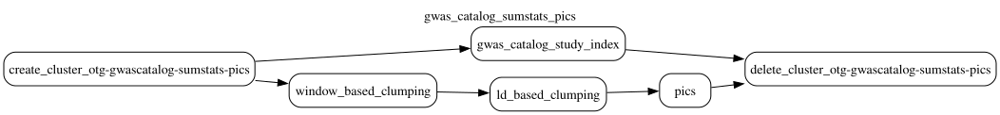

# GWAS Catalog summary statistics PICS

This document was updated on 2026-10-30.

```sh
gs://gwas_catalog_sumstats_pics/prod/20261030T072623/bin/                                   # gentropy CLI and cluster init script of the run
gs://gwas_catalog_sumstats_pics/prod/20261030T072623/config/gwas_catalog_sumstats_pics.yaml # DAG config of the run
gs://gwas_catalog_sumstats_pics/prod/20261030T072623/docs/
gs://gwas_catalog_sumstats_pics/prod/20261030T072623/output/study/
gs://gwas_catalog_sumstats_pics/prod/20261030T072623/output/study_locus/
gs://gwas_catalog_sumstats_pics/prod/20261030T072623/output/ld_annotated_study_locus/
gs://gwas_catalog_sumstats_pics/prod/20261030T072623/output/credible_set/
gs://gwas_catalog_sumstats_pics/prod/20261030T072623/output/credible_set_variant/
```

The summary statistics PICS credible sets are the PICS fine-mapping of the GWAS Catalog summary statistics harmonised to the Open Targets [SummaryStatistics dataset](https://github.com/opentargets/gentropy/blob/v4.0.0-dev.9/src/gentropy/dataset/summary_statistics.py). The release of gentropy v3 is frozen in `gs://gwas_catalog_sumstats_pics/prod/20260828T115527/`.

Data is produced by **gwas_catalog_sumstats_pics DAG**. The DAG configuration and topology are in `config/gwas_catalog_sumstats_pics.yaml` of the run folder (`gs://gwas_catalog_sumstats_pics/prod/20261030T072623/config/`). The run uses gentropy [`v4.0.0-dev.9`](https://github.com/opentargets/gentropy/tree/v4.0.0-dev.9); the links below refer to that tag. `study_index` and `window_clumping` ran on `v4.0.0-dev.8`, whose code of these two steps is the same as in `v4.0.0-dev.9`. The gentropy CLI (`cli.py`) and the cluster init script (`install_dependencies_on_cluster.sh`) of the tag are copied to `bin/` of the run folder.

Inputs of the run:

```sh
gs://gwas_catalog_inputs/gentroutils/20260802/gwas_catalog_download_studies.tsv
gs://gwas_catalog_inputs/gentroutils/20260802/gwas_catalog_download_ancestries.tsv
gs://gwas_catalog_inputs/harmonised_summary_statistics/
gs://gnomad_data_2/v2.1.1/ld_index/
```

The two GWAS Catalog files are synced from the [EBI FTP](https://ftp.ebi.ac.uk/pub/databases/gwas/releases/latest/) by [gentroutils](https://github.com/opentargets/gentroutils), outside this DAG: studies (`gwas_catalog_download_studies.tsv`) and their ancestries (`gwas_catalog_download_ancestries.tsv`). Each sync is written to a folder named after the date of the GWAS Catalog release, `gentroutils/<YYYYMMDD>/`. The harmonised summary statistics are the output of the `gwas_catalog_harmonisation` DAG, one folder per study (`harmonised_summary_statistics/<studyId>/`); see the [GWAS Catalog inputs](../README.md#gwas-catalog-inputs).

The DAG has 4 steps, run on two Dataproc clusters:



| Step | Cluster | After |
|---|---|---|
| study_index | `otg-gwascatalog-sumstats-clumping` | |
| window_clumping | `otg-gwascatalog-sumstats-clumping` | |
| ld_annotation | `otg-gwascatalog-sumstats-pics` | study_index, window_clumping |
| pics | `otg-gwascatalog-sumstats-pics` | ld_annotation |

The clumping cluster has 20 primary and up to 100 spot secondary `n2d-highmem-16` workers (autoscaling policy `otg-efm`), with the shuffle on the primary workers only (Enhanced Flexibility Mode). The PICS cluster has 10 `n2d-highmem-16` workers and is created when the window clumping ends.

## study_index

The step ([`gwas_catalog_study_index.py`](https://github.com/opentargets/gentropy/blob/v4.0.0-dev.9/src/gentropy/gwas_catalog_study_index.py)) builds one study per GWAS Catalog study from the studies and ancestries files ([`study_index.py`](https://github.com/opentargets/gentropy/blob/v4.0.0-dev.9/src/gentropy/datasource/gwas_catalog/study_index.py)). The study index covers every study of the GWAS Catalog release, with or without summary statistics, and carries no curation or summary statistics QC annotation. The output is `output/study/`.

## window_clumping

The step ([`window_based_clumping.py`](https://github.com/opentargets/gentropy/blob/v4.0.0-dev.9/src/gentropy/window_based_clumping.py)) reads the harmonised summary statistics of all studies and keeps, per study, the variants with a p-value of at most 1e-8 that are the most significant within 500 kb ([`window.py`](https://github.com/opentargets/gentropy/blob/v4.0.0-dev.9/src/gentropy/method/clumping/window.py)). Each kept variant is the lead of one study locus, a window of 500 kb on each side of it. The summary statistics of the study inside the window are collected into `locus` (`collect_locus=true`, [`annotation.py`](https://github.com/opentargets/gentropy/blob/v4.0.0-dev.9/src/gentropy/method/annotation.py), `annotate_locus`). The output is `output/study_locus/`.

## ld_annotation

The step ([`ld_based_clumping.py`](https://github.com/opentargets/gentropy/blob/v4.0.0-dev.9/src/gentropy/ld_based_clumping.py)) adds to each study locus the variants in LD with its lead, from the gnomAD v2.1.1 LD index ([`annotation.py`](https://github.com/opentargets/gentropy/blob/v4.0.0-dev.9/src/gentropy/method/annotation.py), `annotate_ld`). The LD population is the major LD population of the study, and only variants with r² of at least 0.5 in that population are kept. A study locus whose lead is in LD with the lead of a more significant study locus of the same study is flagged `Explained by a more significant variant in high LD` and its LD set is emptied ([`ld.py`](https://github.com/opentargets/gentropy/blob/v4.0.0-dev.9/src/gentropy/method/clumping/ld.py)). A study locus with no variant at r² of at least 0.5 in the LD population of its study, the lead included, is flagged `Variant not found in LD reference`, and its LD set holds the lead only: its lead is missing from the LD index, its study has no LD population, or the LD index has no value for that population. The output is `output/ld_annotated_study_locus/`.

## pics

The step ([`pics.py`](https://github.com/opentargets/gentropy/blob/v4.0.0-dev.9/src/gentropy/pics.py)) fine-maps each study locus with [PICS](https://github.com/opentargets/gentropy/blob/v4.0.0-dev.9/src/gentropy/method/fine_mapping/pics.py), from the p-value of the lead and its LD set. Study loci with a lead p-value above 1e-8, or with an empty LD set, give no credible set. Each fine-mapped study locus gives one 95% credible set. The variants of a credible set take their reported statistics from their entry in `locus`. The outputs are `output/credible_set/`, one row per credible set, and `output/credible_set_variant/`, one row per variant of a credible set.

## Known issues

- Summary statistics that list the same variant many times give the lead of a study locus the p-value of an arbitrary one of its entries in `locus` ([opentargets/issues#4637](https://github.com/opentargets/issues/issues/4637)).
- Studies with harmonised summary statistics and no row in the study index of the GWAS Catalog release give credible sets with no study type.

## Outputs

Schemas as read from the parquet files of the run. Nested columns show their `array<struct<...>>` types. "Empty" marks a column with no values in this run.

### study

| Column | Type | Description |
|---|---|---|
| `studyId` | `string` | GWAS Catalog study accession (`GCST…`). |
| `projectId` | `string` | Source of the study: `GCST`. |
| `studyType` | `string` | Type of the study: `gwas`. |
| `pubmedId` | `string` | PubMed id of the publication. |
| `publicationFirstAuthor` | `string` | First author of the publication. |
| `publicationDate` | `string` | Publication date. |
| `publicationJournal` | `string` | Journal of the publication. |
| `publicationTitle` | `string` | Title of the publication. |
| `traitFromSource` | `string` | Trait as reported by the GWAS Catalog. |
| `initialSampleSize` | `string` | Discovery sample as reported, in free text. |
| `traitFromSourceMappedIds` | `array<string>` | Ontology (EFO) terms the trait is mapped to by the GWAS Catalog. |
| `backgroundTraitFromSourceMappedIds` | `array<string>` | Ontology (EFO) terms of the background trait shared by all samples, e.g. a disease of the cohort. |
| `cohorts` | `array<string>` | Cohorts of the study, as reported. |
| `discoverySamples` | `array<struct<ancestry: string, sampleSize: integer>>` | Ancestry and size of each discovery sample. |
| `ldPopulationStructure` | `array<struct<ldPopulation: string, relativeSampleSize: double>>` | LD populations of the discovery samples and their share of the sample; the largest one is the LD population of the study. |
| `replicationSamples` | `array<struct<ancestry: string, sampleSize: integer>>` | Ancestry and size of each replication sample. |
| `nCases` | `integer` | Number of cases. |
| `nControls` | `integer` | Number of controls. |
| `nSamples` | `integer` | Number of samples. |

### study_locus

One row per lead.

| Column | Type | Description |
|---|---|---|
| `id` | `string` | Identifier of the study locus: the md5 hash of `studyId`, `chromosome`, `locusStart` and `locusEnd`. |
| `studyId` | `string` | Study of the summary statistics, as in `study`. |
| `chromosome` | `string` | Chromosome of the lead variant. |
| `locusStart` | `integer` | Start of the window on GRCh38: the position of the lead minus 500 kb. |
| `locusEnd` | `integer` | End of the window on GRCh38: the position of the lead plus 500 kb. |
| `leadVariantId` | `string` | Lead variant, `<chromosome>_<position>_<ref>_<alt>` on GRCh38. |
| `qualityControls` | `array<string>` | Empty. |
| `locus` | `array<struct<variantId: string, pValueMantissa: float, pValueExponent: integer, effectAlleleFrequencyFromSource: float, sampleSize: integer, beta: double, standardError: double>>` | Summary statistics of the study inside the window, sorted by position: p-value (mantissa × 10^exponent), effect allele frequency and sample size where reported, `beta` harmonised to the alternate allele, and `standardError`. |

### ld_annotated_study_locus

The rows and columns of `study_locus`, with the LD flags of `ld_annotation`, and:

| Column | Type | Description |
|---|---|---|
| `ldSet` | `array<struct<tagVariantId: string, r2Overall: float>>` | Variants in LD with the lead (`tagVariantId`) and their r² with it (`r2Overall`) in the LD population of the study; only r² of at least 0.5. Empty for a study locus flagged `Explained by a more significant variant in high LD`. |

### credible_set

One row per credible set.

| Column | Type | Description |
|---|---|---|
| `id` | `string` | Identifier of the credible set: the md5 hash of `studyId`, `chromosome`, `locusStart`, `locusEnd`, `leadVariantId` and `fineMappingMethod`. |
| `chromosome` | `string` | Chromosome of the lead variant. |
| `locusStart` | `integer` | Start of the window of the study locus on GRCh38. |
| `locusEnd` | `integer` | End of the window of the study locus on GRCh38. |
| `studyId` | `string` | Study of the credible set, as in `study`. |
| `studyType` | `string` | Type of the study: `gwas`; null for a study missing from `study`. |
| `leadVariantId` | `string` | Lead variant, `<chromosome>_<position>_<ref>_<alt>` on GRCh38. |
| `fineMappingMethod` | `string` | Fine-mapping method: `PICS`. |
| `logBayesFactor` | `double` | Empty. |
| `confidence` | `tinyint` | Empty. |
| `purityMeanR2` | `double` | Empty. |
| `purityMinR2` | `double` | Empty. |
| `qualityControls` | `array<string>` | Quality control flags of the study locus, plus `Study locus finemapped without in-sample LD reference`. |

### credible_set_variant

One row per variant of a credible set: the variants with the largest posterior probabilities, until they sum to 0.95.

| Column | Type | Description |
|---|---|---|
| `credibleSetId` | `string` | Credible set of the variant, as `id` in `credible_set`. |
| `variantId` | `string` | Variant, `<chromosome>_<position>_<ref>_<alt>` on GRCh38. |
| `pValueMantissa` | `float` | Mantissa of the reported p-value of the variant. |
| `pValueExponent` | `integer` | Exponent of the reported p-value of the variant. |
| `effectAlleleFrequency` | `float` | Frequency of the effect allele, where reported. |
| `sampleSize` | `integer` | Sample size, where reported. |
| `reportedBeta` | `double` | Reported effect size, harmonised to the alternate allele. |
| `reportedStandardError` | `double` | Standard error of `reportedBeta`. |
| `posteriorProbability` | `float` | PICS posterior probability of the variant. |
| `logBayesFactor` | `float` | Empty. |
| `r2Overall` | `float` | r² of the variant with the lead in the LD population of the study. |
| `conditionalBeta` | `float` | Empty. |
| `conditionalStandardError` | `float` | Empty. |
| `rescaledAbsBeta` | `float` | Empty. |
| `rescaledStandardError` | `float` | Empty. |
| `rescaledDirection` | `tinyint` | Empty. |
| `qualityControls` | `array<string>` | Quality control flags of the variant: `Allele frequency reported by the study` for a variant with a reported allele frequency, `Variant in LD with the lead has no statistics in the locus` for a variant without an entry in `locus`, whose statistics are null. |
