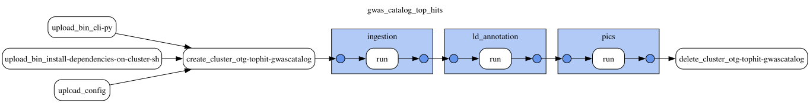

# GWAS Catalog top hits

This document was updated on 2026-10-29.

```sh
gs://gwas_catalog_top_hits/prod/20261028T234317/bin/                              # gentropy CLI and cluster init script of the run
gs://gwas_catalog_top_hits/prod/20261028T234317/config/gwas_catalog_top_hits.yaml # DAG config of the run
gs://gwas_catalog_top_hits/prod/20261028T234317/docs/
gs://gwas_catalog_top_hits/prod/20261028T234317/output/study/
gs://gwas_catalog_top_hits/prod/20261028T234317/output/study_locus/
gs://gwas_catalog_top_hits/prod/20261028T234317/output/ld_annotated_study_locus/
gs://gwas_catalog_top_hits/prod/20261028T234317/output/credible_set/
gs://gwas_catalog_top_hits/prod/20261028T234317/output/credible_set_variant/
```

Data contained in the `top_hits` corresponds to the [GWAS Catalog top associations](https://www.ebi.ac.uk/gwas/docs/methods/criteria#:~:text=statistics%20here.-,Top%20associations,-We%20also%20report)

Data is produced by **gwas_catalog_top_hits DAG**. The DAG configuration and topology are in `config/gwas_catalog_top_hits.yaml` of the run folder (`gs://gwas_catalog_top_hits/prod/20261028T234317/config/`). The run uses gentropy [`v4.0.0-dev.4`](https://github.com/opentargets/gentropy/tree/v4.0.0-dev.4); the links below refer to that tag. The gentropy CLI (`cli.py`) and the cluster init script (`install_dependencies_on_cluster.sh`) of the tag are copied to `bin/` of the run folder.

Inputs of the run:

```sh
gs://gwas_catalog_inputs/gentroutils/20260802/gwas_catalog_download_studies.tsv
gs://gwas_catalog_inputs/gentroutils/20260802/gwas_catalog_download_ancestries.tsv
gs://gwas_catalog_inputs/gentroutils/20260802/gwas_catalog_associations_ontology_annotated.tsv
gs://gnomad_data_2/v4.1/variant_index/
gs://gnomad_data_2/v2.1.1/ld_index/
```

The three GWAS Catalog files are synced from the [EBI FTP](https://ftp.ebi.ac.uk/pub/databases/gwas/releases/latest/) by [gentroutils](https://github.com/opentargets/gentroutils), outside this DAG: studies (`gwas_catalog_download_studies.tsv`), their ancestries (`gwas_catalog_download_ancestries.tsv`) and the curated associations with their ontology annotations (`gwas_catalog_associations_ontology_annotated.tsv`). Each sync is written to a folder named after the date of the GWAS Catalog release, `gentroutils/<YYYYMMDD>/`.

The DAG has 3 steps, run one after another on one Dataproc cluster:



1. ingestion
2. ld_annotation
3. pics

## ingestion

The step ([`gwas_catalog_top_hits.py`](https://github.com/opentargets/gentropy/blob/v4.0.0-dev.4/src/gentropy/gwas_catalog_top_hits.py)) maps the curated associations to the gnomAD v4.1 variant index and splits the GWAS Catalog studies by the trait, `P-VALUE (TEXT)` label and EFO terms of their associations ([`study_splitter.py`](https://github.com/opentargets/gentropy/blob/v4.0.0-dev.4/src/gentropy/datasource/gwas_catalog/study_splitter.py)). Each association becomes a study locus. A study locus within 500 kb of a more significant one of the same study is flagged `Explained by a more significant variant in the same window` and kept ([`associations.py`](https://github.com/opentargets/gentropy/blob/v4.0.0-dev.4/src/gentropy/datasource/gwas_catalog/associations.py), `window_clump`). The outputs are `output/study/` and `output/study_locus/`.

## ld_annotation

The step ([`ld_based_clumping.py`](https://github.com/opentargets/gentropy/blob/v4.0.0-dev.4/src/gentropy/ld_based_clumping.py)) adds to each study locus the variants in LD with its lead, from the gnomAD v2.1.1 LD index ([`annotation.py`](https://github.com/opentargets/gentropy/blob/v4.0.0-dev.4/src/gentropy/method/annotation.py), `annotate_ld`). The LD population is the major LD population of the study, and only variants with r² of at least 0.5 are kept. A study locus whose lead is in LD with the lead of a more significant study locus of the same study is flagged `Explained by a more significant variant in high LD` and its LD set is emptied ([`ld.py`](https://github.com/opentargets/gentropy/blob/v4.0.0-dev.4/src/gentropy/method/clumping/ld.py)). The output is `output/ld_annotated_study_locus/`.

## pics

The step ([`pics.py`](https://github.com/opentargets/gentropy/blob/v4.0.0-dev.4/src/gentropy/pics.py)) fine-maps each study locus with [PICS](https://github.com/opentargets/gentropy/blob/v4.0.0-dev.4/src/gentropy/method/fine_mapping/pics.py), from the p-value of the lead and its LD set. Study loci with a lead p-value above 1e-8, or with an empty LD set, give no credible set. Each fine-mapped study locus gives one 95% credible set. The outputs are `output/credible_set/`, one row per credible set, and `output/credible_set_variant/`, one row per variant of a credible set.

## Outputs

Schemas as read from the parquet files of the run. Nested columns show their `array<struct<...>>` types. "Empty" marks a column with no values in this run.

| Output | Rows | Files |
|---|---|---|
| `study` | 230,547 | 1 |
| `study_locus` | 957,075 | 1 |
| `ld_annotated_study_locus` | 957,075 | 4 |
| `credible_set` | 701,675 | 2 |
| `credible_set_variant` | 19,577,608 | 2 |

### study

| Column | Type | Description |
|---|---|---|
| `studyId` | `string` | GWAS Catalog study accession (`GCST…`); a split study has a suffix (`GCST…_2`, `GCST…_3`, …). |
| `projectId` | `string` | Source of the study: `GCST`. |
| `studyType` | `string` | Type of the study: `gwas`. |
| `pubmedId` | `string` | PubMed id of the publication. |
| `publicationFirstAuthor` | `string` | First author of the publication. |
| `publicationDate` | `string` | Publication date. |
| `publicationJournal` | `string` | Journal of the publication. |
| `publicationTitle` | `string` | Title of the publication. |
| `traitFromSource` | `string` | Trait as reported by the GWAS Catalog; for a split study, followed by the label of its associations in brackets. |
| `initialSampleSize` | `string` | Discovery sample as reported, in free text. |
| `traitFromSourceMappedIds` | `array<string>` | Ontology (EFO) terms the trait is mapped to by the GWAS Catalog. |
| `backgroundTraitFromSourceMappedIds` | `array<string>` | Ontology (EFO) terms of the background trait shared by all samples, e.g. a disease of the cohort. |
| `cohorts` | `array<string>` | Cohorts of the study, as reported. |
| `discoverySamples` | `array<struct<ancestry: string, sampleSize: integer>>` | Ancestry and size of each discovery sample. |
| `ldPopulationStructure` | `array<struct<ldPopulation: string, relativeSampleSize: double>>` | LD populations of the discovery samples and their share of the sample; the largest one is the LD population of the study. |
| `replicationSamples` | `array<struct<ancestry: string, sampleSize: integer>>` | Ancestry and size of each replication sample. |
| `nCases` | `integer` | Number of cases. |
| `nControls` | `integer` | Number of controls. |
| `nSamples` | `integer` | Number of samples. |
| `qualityControls` | `array<string>` | Quality control flags of the study. |

### study_locus

One row per curated association mapped to the variant index.

| Column | Type | Description |
|---|---|---|
| `id` | `string` | Identifier of the study locus: the md5 hash of `studyId`, `chromosome`, `locusStart` and `locusEnd`. |
| `studyId` | `string` | Study of the association, as in `study`. |
| `chromosome` | `string` | Chromosome of the lead variant. |
| `locusStart` | `integer` | Position of the lead variant on GRCh38. |
| `locusEnd` | `integer` | Position of the lead variant on GRCh38 (equal to `locusStart`). |
| `leadVariantId` | `string` | Lead variant, `<chromosome>_<position>_<ref>_<alt>` on GRCh38, from the gnomAD v4.1 variant index. |
| `qualityControls` | `array<string>` | Quality control flags of the study locus. |
| `locus` | `array<struct<variantId: string, pValueMantissa: float, pValueExponent: integer, effectAlleleFrequencyFromSource: float, sampleSize: integer, beta: double, standardError: double>>` | Statistics of the lead variant, one entry: the reported p-value (mantissa × 10^exponent), `beta` harmonised to the alternate allele of the lead (reported odds ratios are converted to beta), and `standardError`, derived from the effect size and the p-value or from the odds ratio confidence interval. |

### ld_annotated_study_locus

The rows and columns of `study_locus`, with the LD flags of `ld_annotation`, and:

| Column | Type | Description |
|---|---|---|
| `ldSet` | `array<struct<tagVariantId: string, r2Overall: float>>` | Variants in LD with the lead (`tagVariantId`) and their r² with it (`r2Overall`) in the LD population of the study; only r² of at least 0.5. Empty for a study locus flagged `Explained by a more significant variant in high LD`. |

### credible_set

One row per credible set.

| Column | Type | Description |
|---|---|---|
| `id` | `string` | Identifier of the credible set: the md5 hash of `studyId`, `chromosome`, `locusStart`, `locusEnd`, `leadVariantId` and `fineMappingMethod`. |
| `chromosome` | `string` | Chromosome of the lead variant. |
| `locusStart` | `integer` | Position of the lead variant on GRCh38. |
| `locusEnd` | `integer` | Position of the lead variant on GRCh38 (equal to `locusStart`). |
| `studyId` | `string` | Study of the credible set, as in `study`. |
| `studyType` | `string` | Type of the study: `gwas`. |
| `leadVariantId` | `string` | Lead variant, `<chromosome>_<position>_<ref>_<alt>` on GRCh38. |
| `fineMappingMethod` | `string` | Fine-mapping method: `PICS`. |
| `logBayesFactor` | `double` | Empty. |
| `confidence` | `tinyint` | Empty. |
| `purityMeanR2` | `double` | Empty. |
| `purityMinR2` | `double` | Empty. |
| `qualityControls` | `array<string>` | Quality control flags of the study locus, plus `Study locus finemapped without in-sample LD reference`. |

### credible_set_variant

One row per variant of a credible set: the variants with the largest posterior probabilities, until they sum to 0.95.

| Column | Type | Description |
|---|---|---|
| `credibleSetId` | `string` | Credible set of the variant, as `id` in `credible_set`. |
| `variantId` | `string` | Variant, `<chromosome>_<position>_<ref>_<alt>` on GRCh38. |
| `pValueMantissa` | `float` | Mantissa of the reported p-value; only for the lead. |
| `pValueExponent` | `integer` | Exponent of the reported p-value; only for the lead. |
| `effectAlleleFrequency` | `float` | Empty. |
| `sampleSize` | `integer` | Empty. |
| `reportedBeta` | `double` | Reported effect size harmonised to the alternate allele; only for the lead, where reported. |
| `reportedStandardError` | `double` | Standard error of `reportedBeta`; only for the lead, where reported. |
| `posteriorProbability` | `float` | PICS posterior probability of the variant. |
| `logBayesFactor` | `float` | Empty. |
| `r2Overall` | `float` | r² of the variant with the lead in the LD population of the study. |
| `conditionalBeta` | `float` | Empty. |
| `conditionalStandardError` | `float` | Empty. |
| `rescaledAbsBeta` | `float` | Empty. |
| `rescaledStandardError` | `float` | Empty. |
| `rescaledDirection` | `tinyint` | Empty. |
| `qualityControls` | `array<string>` | Quality control flags of the variant: `Variant in LD with the lead has no statistics in the locus` for every variant other than the lead. |
