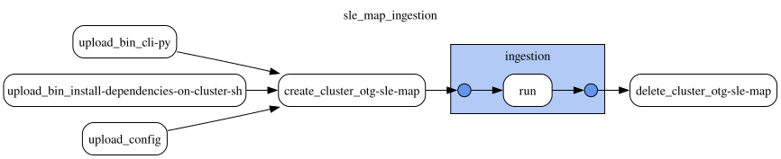

# SLE-map single-cell eQTLs

This document was updated on 2026-11-17.

SLE-map ([preprint](https://doi.org/10.64898/2026.09.18.752560)) maps cis-eQTLs in 16 peripheral blood cell types of 281 donors of a systemic lupus erythematosus cohort, and fine-maps them with SuSiE-RSS and in-sample LD. The data is part of the OTAR2064 project and is read by the Partner Preview Platform (PPP) only.

One study per cell type and gene (`SLEmap_sceqtl_<cell type>_<ENSG>`), of study type `sceqtl`.

## Run folder

The release read by `pis` was produced on 2026-09-23 outside of this repository, by `slemap_ingest.py` on a Dataproc cluster (opentargets/issues#4538), and written to a personal bucket (`gs://ot-team/tobi/credible_set_datasets/SLEmap_finemap/results/processing/20260923T222644Z/`). It was copied into a dated run folder of `gs://sle_map_data` on 2026-11-03, before SLE-map moves to the new credible set schema. Nothing in it was changed.

```sh
gs://sle_map_data/prod/20260923T222644/
├── config/   slemap_ingest.py, run_slemap_on_master.sh, SLEmap_ontology_mapping.tsv
├── docs/     README.md
└── output/
    ├── study/                   # 10,104 studies, gentropy StudyIndex
    ├── credible_set/            # 9,768 credible sets, gentropy 3.x StudyLocus
    ├── excluded/{study,credible_set}
    ├── audit/{reconstruction,effect_sizes,allele_swaps,ancestry_assumptions,source_rejection_ledger}
    └── run_manifest/
```

The timestamp is the time of the run folder of the release (`20260923T222644Z`).

## Inputs

The SuSiE-RSS results of SLE-map were copied from the same personal bucket to `gs://sle_map_data/raw_data/`, so that a rerun does not depend on it (43.2 GB):

```sh
gs://sle_map_data/raw_data/all_credible_sets.tsv   # every variant tested, per cell type and gene: z, PIP and log Bayes factors of the 10 SuSiE effects (L1..L10), credible set flags
gs://sle_map_data/raw_data/all_diagnostics.tsv     # per cell type and gene: sample size, number of credible sets and variants, fit status
gs://sle_map_data/raw_data/eQTL_nominal/           # TensorQTL nominal summary statistics (beta, standard error, allele frequency), 16 archives
```

`slemap_ingest.py` also read the gnomAD variant index, the target index and the biosample index of the platform release (see `config/run_slemap_on_master.sh`).

## Processing

`slemap_ingest.py` (in `config/`):

1. Reconstructs the 95% credible sets of every SuSiE effect reported by SLE-map, from the per-effect posterior probabilities of `all_credible_sets.tsv`.
2. Matches the variants to gnomAD (no REF/ALT swap was needed) and takes the effect sizes and allele frequencies of the members from the nominal summary statistics.
3. Rejects whole credible sets that fail a check, with the reasons in `output/excluded/` and `output/audit/reconstruction`: diagnostics, posterior mass, missing effect sizes or allele frequencies, z-scores inconsistent with the effect sizes, unresolved genes or biosamples, MHC, lead p-value above 0.001.
4. Writes one study per cell type and gene with a credible set reported, and the credible sets as a gentropy 3.x `StudyLocus` (`finemappingMethod` `SuSie`, `confidence` in-sample LD, `isTransQtl` with a 5 Mb window).

The run manifest: 10,075 credible sets before the quality controls, 9,768 accepted, 1,906 components excluded, 87 by the lead p-value; 119,442 accepted members, every one with an effect size.

- Sample sizes: the study `discoverySamples` split each study's sample size over the ancestries of the whole cohort (no ancestry per study was given), as described in `initialSampleSize`.
- The credible set `credibleSetlog10BF` is over the members of the credible set only.
- Purity is empty: SLE-map gives no LD.

## Release

| | Count |
|---|---:|
| studies | 10,104 |
| studies with credible sets | 9,743 |
| credible sets | 9,768 |
| members | 119,442 (median 5 per credible set, max 1,007) |

16 cell types: peripheral blood mononuclear cells (`CL_2000001`, all cells, 2,556 studies) and 15 cell types of `config/SLEmap_ontology_mapping.tsv`. Every credible set is `sceqtl`, in-sample LD, not trans, with no quality control flag, and with posterior probabilities summing to 0.95–1.0.

## v4 ingestion (`sle_map_ingestion`)

The staging DAG `sle_map_ingestion` runs the gentropy step `sle_map_ingestion` (opentargets/gentropy#1354) on the SuSiE results of the new SLE-map fine-mapping run (`SLEmap_finemap_cond`), and writes the study index, `CredibleSet` and `CredibleSetVariant` to a new run folder. It replaces the one-off conversion of the earlier release (#272).



```sh
gs://sle_map_data/raw_results/SLEmap_finemap_cond/
├── all_memberships.tsv         # read: one row per credible set member, marginal and conditional effects
├── all_components.tsv          # read: one row per credible set, purity, region log Bayes factor
├── all_diagnostics.tsv         # read: one row per cell type and gene fitted, sample size
├── all_credible_sets.tsv       # not read: every variant tested (28.6 GB)
├── all_variant_statistics.tsv  # not read (10.8 GB)
├── all_manifests.tsv
├── fits/                       # SuSiE fits per cell type and batch
└── pipeline_info/
```

```sh
gs://sle_map_data/prod/20261117T133750/
├── bin/      cli.py, install_dependencies_on_cluster.sh of the gentropy ref
├── docs/     README.md, sle_map_ingestion.svg
└── output/
    ├── study/
    ├── credible_set/
    └── credible_set_variant/
```

- Filters: purity min r² ≥ 0.25 and lead p-value ≤ 0.001 (step defaults). MHC is left to validation.
- Conditional effects are SuSiE's own, per standard deviation of genotype and expression.

Run `20261117T133750` on 2026-11-17 (gentropy `f8719e6`): 7 min in all, 1.5 min of Spark on 2 workers.

| | Count |
|---|---:|
| studies | 10,097 |
| credible sets | 11,221 |
| members | 147,984 |
| distinct variants | 83,476 |

16 cell types, every study with a biosample and an LD population structure. Every credible set has a study, members and a log Bayes factor, its lead among the members, purity min r² ≥ 0.25, and posterior probabilities summing to 0.95–1.0. Every member has `reportedBeta`, `conditionalBeta`, `effectAlleleFrequency` and `sampleSize`. Ids are unique.

## Changelog

### 2026-11-17

* Added the staging DAG `sle_map_ingestion`; run folder `gs://sle_map_data/prod/20261117T133750/`. `pis` reads it.

### 2026-11-03

* Copied the release from `gs://ot-team/tobi/credible_set_datasets/SLEmap_finemap/results/processing/20260923T222644Z/` into the run folder `gs://sle_map_data/prod/20260923T222644/`, and the SuSiE-RSS results into `gs://sle_map_data/raw_data/`. `pis` reads the run folder. The personal bucket is not changed.
