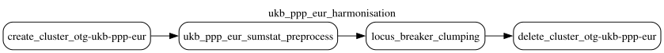
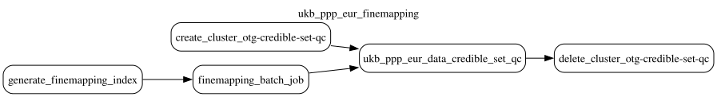

# UK Biobank Pharma Proteomics Project (UKB-PPP)

This document was updated on 2026-10-30.

```sh
gs://ukb_ppp_eur_data/prod/20260526T131650/config/                                   # DAG configs of the run
gs://ukb_ppp_eur_data/prod/20260526T131650/docs/
gs://ukb_ppp_eur_data/prod/20260526T131650/output/study_index/
gs://ukb_ppp_eur_data/prod/20260526T131650/output/study_locus_lb_clumped/
gs://ukb_ppp_eur_data/prod/20260526T131650/output/finemapping_manifests/20250129/
gs://ukb_ppp_eur_data/prod/20260526T131650/output/finemapping_logs/20250129/
gs://ukb_ppp_eur_data/prod/20260526T131650/output/credible_set_datasets/susie/20250129/
gs://ukb_ppp_eur_data/prod/20260526T131650/output/credible_set_clean/20250129/
gs://ukb_ppp_eur_inputs/harmonised_summary_statistics/                               # input, not part of the run folder
```

Data contained in the run corresponds to the European discovery protein GWAS (pGWAS) of the [UK Biobank Pharma Proteomics Project](https://www.nature.com/articles/s41586-023-06592-6), published in the [UKB-PPP open data registry](https://registry.opendata.aws/ukbppp/).

Data is produced by two DAGs, **ukb_ppp_eur_harmonisation** and **ukb_ppp_eur_finemapping**. The DAG configurations and topologies are in `config/ukb_ppp_eur_harmonisation.yaml` and `config/ukb_ppp_eur_finemapping.yaml` of the run folder (`gs://ukb_ppp_eur_data/prod/20260526T131650/config/`). The steps use these gentropy tags; the links below refer to them:

| DAG | Step | gentropy |
|---|---|---|
| ukb_ppp_eur_harmonisation | ukb_ppp_eur_sumstat_preprocess, locus_breaker_clumping | [`v2.3.0-rc.5`](https://github.com/opentargets/gentropy/tree/v2.3.0-rc.5) (`GENTROPY_REF`) |
| ukb_ppp_eur_finemapping | finemapping_batch_job | [`v2.0.2-rc.2`](https://github.com/opentargets/gentropy/tree/v2.0.2-rc.2) (`gentropy_ref`, the tag of the gentropy image) |
| ukb_ppp_eur_finemapping | ukb_ppp_eur_data_credible_set_qc | [`v3.2.0`](https://github.com/opentargets/gentropy/tree/v3.2.0) (`GENTROPY_REF`) |

The run folder is named after the data freeze: the move of the release from the top level of `gs://ukb_ppp_eur_data/` into a dated folder. The run outputs were written to the top level of `gs://ukb_ppp_eur_data/`, moved to `gs://ukb_ppp_eur_data/prod/20260526T131650/` on 2026-10-26, and moved under `output/` on 2026-10-30. The fine-mapping outputs keep the `20250129` folder of the fine-mapping run.

Inputs of the run:

```sh
gs://gentropy-vault/ukb-ppp/
gs://gentropy-tmp/batch/output/ukb_ppp_eur/study_index.tsv
gs://gentropy-tmp/batch/output/ukb_ppp_eur/summary_stats.parquet
gs://gnomad_data_2/gnomad_variant_index
gs://panukbb-ld-matrixes/UKBB.EUR.ldadj
gs://panukbb-ld-matrixes/ukb-diverse-pops-public-build-38/UKBB.EUR.ldadj.variant.b38
```

`gs://gentropy-vault/ukb-ppp/` is the mirror of the UKB-PPP pGWAS summary statistics, one TAR file per protein, made by hand following the [gentropy-vault protocol](https://github.com/opentargets/gentropy-vault/blob/main/datasets/ukb-ppp.md). [gentropy-input-support](https://github.com/opentargets/gentropy-input-support) (`./submit.py ukb_ppp_eur`, [data_sources.py](https://github.com/opentargets/gentropy-input-support/blob/dc5f8f7aee13a066933f3fd5b18a9b3a5ca71069/data_sources.py#L43-L103)) reads the mirror on Google Batch, outside the DAGs, and writes `study_index.tsv` and `summary_stats.parquet` to `gs://gentropy-tmp/`:

- The per-chromosome files are extracted from the TAR files and partitioned by chromosome.
- The study identifier is recreated, because several rows of the source study table share one summary statistics file.
- Rows of the source study table without a summary statistics file are dropped.

`gs://gentropy-tmp/` deletes its objects after 60 days, so these two inputs no longer exist.

The harmonisation DAG has 2 steps, run one after another on one Dataproc cluster:



1. ukb_ppp_eur_sumstat_preprocess
2. locus_breaker_clumping

The fine-mapping DAG has 3 steps, run one after another: the index and the fine-mapping jobs on Google Batch, and the quality control on one Dataproc cluster:



1. generate_finemapping_index
2. finemapping_batch_job
3. ukb_ppp_eur_data_credible_set_qc

## ukb_ppp_eur_sumstat_preprocess

The step ([`ukb_ppp_eur_sumstat_preprocess.py`](https://github.com/opentargets/gentropy/blob/v2.3.0-rc.5/src/gentropy/ukb_ppp_eur_sumstat_preprocess.py)) builds the study index and harmonises the summary statistics.

The study index ([`study_index.py`](https://github.com/opentargets/gentropy/blob/v2.3.0-rc.5/src/gentropy/datasource/ukb_ppp_eur/study_index.py)) has one study per row of `study_index.tsv`. The sample size of a study is the `N` of its chromosome 22 summary statistics; a study without chromosome 22 summary statistics is dropped. The output is `output/study_index/`.

The summary statistics ([`summary_stats.py`](https://github.com/opentargets/gentropy/blob/v2.3.0-rc.5/src/gentropy/datasource/ukb_ppp_eur/summary_stats.py), [`harmonise.py`](https://github.com/opentargets/gentropy/blob/v2.3.0-rc.5/src/gentropy/common/harmonise.py)) are harmonised one chromosome at a time:

- Chromosome 23 is renamed to X.
- Variants with an `INFO` below 0.8, or a minor allele frequency below 0.0001, are dropped.
- Each variant is matched to the gnomAD variant index (`gs://gnomad_data_2/gnomad_variant_index`) in its own allele order or in the flipped order. A flipped variant has its `BETA` negated and its allele frequency replaced by 1 − frequency.
- A flipped strand-ambiguous SNP (A/T or G/C) is dropped. Variants not in the variant index are dropped.
- Rows with a null position or a `BETA` of 0 are dropped.

The output is `gs://ukb_ppp_eur_inputs/harmonised_summary_statistics/`, partitioned by `studyId` and `chromosome`. It is an input bucket, and the run folder does not hold it.

## locus_breaker_clumping

The step ([`locus_breaker_clumping.py`](https://github.com/opentargets/gentropy/blob/v2.3.0-rc.5/src/gentropy/locus_breaker_clumping.py)) finds the loci of each study in the harmonised summary statistics:

- Locus-breaker clumping ([`locus_breaker_clumping.py`](https://github.com/opentargets/gentropy/blob/v2.3.0-rc.5/src/gentropy/method/locus_breaker_clumping.py)) joins the variants with a p-value below 1e-5 that are less than 250 kb apart into one locus, keeps the loci whose lead has a p-value below 1.7e-11, and extends each locus by 100 kb on both sides.
- A locus longer than 1.5 Mb is replaced by the windows of window-based clumping (500 kb, p-value below 1.7e-11) whose lead is inside it. Each such window spans 1.5 Mb centred on its lead.
- Loci overlapping the MHC region are dropped.
- The summary statistics of each locus are collected into `locus`.

The output is `output/study_locus_lb_clumped/`, partitioned by `studyLocusId`: 17,670 loci.

## generate_finemapping_index

The step (`BatchIndexOperator`, pointer `finemapping`) lists the loci of `output/study_locus_lb_clumped/` and writes a manifest of their input, output and log paths. The manifests are in `output/finemapping_manifests/20250129/`, in two folders, `20250129091658/` and `20250129143059/`, each with a `chunk_0` manifest.

## finemapping_batch_job

The step runs one Google Batch task per locus of the manifest. Each task runs `susie_finemap.sh`, which calls the gentropy step `susie_finemapping` ([`susie_finemapper.py`](https://github.com/opentargets/gentropy/blob/v2.0.2-rc.2/src/gentropy/susie_finemapper.py)):

- The LD matrix of the locus is the Pan-UKBB `EUR` LD matrix, for a study whose major LD population is `nfe` ([`ld_matrix_interface.py`](https://github.com/opentargets/gentropy/blob/v2.0.2-rc.2/src/gentropy/method/ld_matrix_interface.py)). Only variants present in both the locus and the LD matrix are fine-mapped. Every UKB-PPP study has the LD population `nfe`.
- The locus is fine-mapped with [SuSiE-inf](https://github.com/opentargets/gentropy/blob/v2.0.2-rc.2/src/gentropy/method/susie_inf.py), with at most 10 causal variants. Each credible set holds the variants with the largest posterior probabilities, until they sum to 0.95.
- A credible set is kept when its lead has a p-value of at most 1e-5, its natural log Bayes factor is at least 2 (`credibleSetlog10BF` of at least 0.8686), and its mean and minimum purity r² are at least 0.25.
- Of two credible sets with the same lead, the one with the lower credible set index is kept. Of two credible sets whose leads have an r² of at least 0.8, the one whose lead has the larger p-value is dropped.
- Every credible set is flagged `Study locus finemapped without in-sample LD reference`.

The output is `output/credible_set_datasets/susie/20250129/`, one folder per locus: 16,974 folders. The logs of the tasks are in `output/finemapping_logs/20250129/`, one `<studyLocusId>.log` file per locus.

## ukb_ppp_eur_data_credible_set_qc

The step ([`credible_set_qc.py`](https://github.com/opentargets/gentropy/blob/v3.2.0/src/gentropy/credible_set_qc.py), [`susie_inf.py`](https://github.com/opentargets/gentropy/blob/v3.2.0/src/gentropy/method/susie_inf.py), `credible_set_qc`) reads all credible sets of `output/credible_set_datasets/susie/20250129/`:

- Credible sets with a lead p-value above 1e-5, or a minimum purity r² below 0.25, are dropped.
- Of the credible sets with the same `studyLocusId`, the one with the largest `credibleSetlog10BF` is kept.
- No LD clumping is done (`clump: false`).

The output is `output/credible_set_clean/20250129/`: 32,179 credible sets from 2,378 studies. This is the dataset that the platform reads.

## Outputs

Schemas as read from the parquet files of the run. Nested columns show their `array<struct<...>>` types. "Empty" marks a column with no values in this run.

| Output | Rows | Files |
|---|---|---|
| `study_index` | 2,957 | 1 |
| `study_locus_lb_clumped` | 17,670 | 1 per locus |
| `credible_set_datasets/susie/20250129` | 1 folder per fine-mapped locus (16,974) | 1 or more per locus |
| `credible_set_clean/20250129` | 32,179 | 16 |

### study_index

One row per protein assay.

| Column | Type | Description |
|---|---|---|
| `studyId` | `string` | `UKB_PPP_EUR_<gene>_<UniProt>_<OlinkId>_v<version>`, e.g. `UKB_PPP_EUR_A1BG_P04217_OID30771_v1`. |
| `studyType` | `string` | `pqtl`. |
| `projectId` | `string` | `UKB_PPP_EUR`. |
| `traitFromSource` | `string` | UKB-PPP protein identifier, `<gene>:<UniProt>:<OlinkId>:v<version>`. |
| `biosampleFromSourceId` | `string` | `UBERON_0001969` (blood plasma). |
| `geneId` | `string` | Ensembl gene of the protein. 2,937 distinct genes. |
| `hasSumstats` | `boolean` | `true`. |
| `summarystatsLocation` | `string` | TAR file of the study in the summary statistics mirror, `gs://gentropy-vault/ukb-ppp/…`. |
| `nSamples` | `integer` | Sample size of the study, 9,216 to 34,090. |
| `discoverySamples` | `array<struct<sampleSize: integer, ancestry: string>>` | One sample: `nSamples` and the ancestry `European`. |
| `ldPopulationStructure` | `array<struct<ldPopulation: string, relativeSampleSize: double>>` | `nfe` with a relative sample size of 1.0. |

### study_locus_lb_clumped

One row per locus, in one folder per `studyLocusId`.

| Column | Type | Description |
|---|---|---|
| `studyLocusId` | `string` | Identifier of the locus (the partition folder). |
| `studyId` | `string` | Study of the locus, as in `study_index`. |
| `variantId` | `string` | Lead variant, `<chromosome>_<position>_<ref>_<alt>` on GRCh38. |
| `chromosome` | `string` | Chromosome of the lead. |
| `position` | `integer` | Position of the lead on GRCh38. |
| `locusStart` | `integer` | Start of the locus. |
| `locusEnd` | `integer` | End of the locus. |
| `beta` | `double` | Effect size of the lead. |
| `standardError` | `double` | Standard error of the lead. |
| `pValueMantissa` | `float` | Mantissa of the p-value of the lead (p = mantissa × 10^exponent). |
| `pValueExponent` | `integer` | Exponent of the p-value of the lead. |
| `effectAlleleFrequencyFromSource` | `float` | Frequency of the effect allele of the lead. |
| `sampleSize` | `integer` | Sample size of the lead. |
| `qualityControls` | `array<string>` | Quality control flags of the locus. |
| `locus` | `array<struct<variantId: string, beta: double, pValueMantissa: float, pValueExponent: integer, standardError: double>>` | Summary statistics of every variant between `locusStart` and `locusEnd`. |

### credible_set_datasets/susie/20250129

One folder per fine-mapped locus, named after the `studyLocusId` of the locus in `study_locus_lb_clumped`. One row per credible set.

| Column | Type | Description |
|---|---|---|
| `studyLocusId` | `string` | Identifier of the credible set: a hash of `studyId`, `variantId` and `finemappingMethod`. |
| `studyId` | `string` | Study of the credible set, as in `study_index`. |
| `credibleSetIndex` | `integer` | Index of the credible set within the locus, 1 to 10. |
| `region` | `string` | Fine-mapped region, `<chromosome>:<start>-<end>`. |
| `variantId` | `string` | Lead variant, the variant of the credible set with the largest posterior probability. |
| `chromosome` | `string` | Chromosome of the lead. |
| `position` | `integer` | Position of the lead on GRCh38. |
| `finemappingMethod` | `string` | `SuSiE-inf`. |
| `credibleSetlog10BF` | `double` | Log10 Bayes factor of the credible set. |
| `purityMeanR2` | `double` | Mean r² between the variants of the credible set. |
| `purityMinR2` | `double` | Minimum r² between the variants of the credible set. |
| `zScore` | `double` | Z-score of the lead. |
| `pValueMantissa` | `float` | Mantissa of the p-value of the lead. |
| `pValueExponent` | `integer` | Exponent of the p-value of the lead. |
| `locusStart` | `integer` | Start of the locus in `study_locus_lb_clumped`. |
| `locusEnd` | `integer` | End of the locus in `study_locus_lb_clumped`. |
| `beta` | `double` | Effect size of the lead, from `locus`. |
| `qualityControls` | `array<string>` | `Study locus finemapped without in-sample LD reference`. |
| `locus` | `array<struct<variantId: string, posteriorProbability: double, logBF: double, beta: double>>` | Variants of the credible set with their posterior probability, log Bayes factor and effect. |

### credible_set_clean/20250129

One row per credible set: the rows of `credible_set_datasets/susie/20250129` that pass the quality control, in the `StudyLocus` schema of gentropy `v3.2.0`.

| Column | Type | Description |
|---|---|---|
| `studyLocusId` | `string` | Identifier of the credible set, as in `credible_set_datasets/susie/20250129`. |
| `studyType` | `string` | Empty. |
| `variantId` | `string` | Lead variant, `<chromosome>_<position>_<ref>_<alt>` on GRCh38. |
| `chromosome` | `string` | Chromosome of the lead. |
| `position` | `integer` | Position of the lead on GRCh38. |
| `region` | `string` | Fine-mapped region, `<chromosome>:<start>-<end>`. 12,121 distinct regions. |
| `studyId` | `string` | Study of the credible set, as in `study_index`. Every study is in `study_index`. |
| `beta` | `double` | Effect of the lead, from `locus`. |
| `zScore` | `double` | Z-score of the lead. |
| `pValueMantissa` | `float` | Mantissa of the p-value of the lead. |
| `pValueExponent` | `integer` | Exponent of the p-value of the lead. Every p-value is at most 1e-5. |
| `effectAlleleFrequencyFromSource` | `float` | Empty. |
| `standardError` | `double` | Empty. |
| `subStudyDescription` | `string` | Empty. |
| `qualityControls` | `array<string>` | `Study locus finemapped without in-sample LD reference`. |
| `finemappingMethod` | `string` | `SuSiE-inf`. |
| `credibleSetIndex` | `integer` | Index of the credible set within the locus, 1 to 10. |
| `credibleSetlog10BF` | `double` | Log10 Bayes factor of the credible set. |
| `purityMeanR2` | `double` | Mean r² between the variants of the credible set. |
| `purityMinR2` | `double` | Minimum r² between the variants of the credible set, at least 0.25. |
| `locusStart` | `integer` | Start of the locus. |
| `locusEnd` | `integer` | End of the locus. |
| `sampleSize` | `integer` | Empty. |
| `ldSet` | `array<struct<tagVariantId: string, r2Overall: double>>` | Empty. |
| `locus` | `array<struct<is95CredibleSet: boolean, is99CredibleSet: boolean, logBF: double, posteriorProbability: double, variantId: string, pValueMantissa: float, pValueExponent: integer, beta: double, standardError: double, r2Overall: double>>` | Variants of the credible set, 1 to 2,848 per credible set. Only `variantId`, `posteriorProbability`, `logBF` and `beta` have values. |
| `confidence` | `string` | Empty. |
| `isTransQtl` | `boolean` | Empty. |

## Changelog

### 2025-02-05

- [fix: repair SusieFinemapperStep to work with new SL schema #957](https://github.com/opentargets/gentropy/pull/957) resolved [issue](https://github.com/opentargets/issues/issues/3667)

### 2025-04-11

- chore: harmonised summary statistics were moved from `gs://ukb_ppp_eur_data/harmonised_summary_statistics` to `gs://ukb_ppp_eur_inputs/harmonised_summary_statistics`. Summary statistics are now in the archive bucket (cold storage).
- chore: removal of 2024-10-21 credible sets due to data duplication.

### 2026-09-16

- chore: moved the qc step from `credible_set_qc` dag to ukb_ppp_eur_finemapping dag.

### 2026-10-30

- chore: move the UKB-PPP release from the top level of `gs://ukb_ppp_eur_data/` to `gs://ukb_ppp_eur_data/prod/20260526T131650/` (`config/`, `docs/`, `output/`), following [opentargets/issues#4613](https://github.com/opentargets/issues/issues/4613). The DAGs write to `output/` of the run folder.
- chore: the credible set quality control paths of `ukb_ppp_eur_finemapping` follow `root_path` and `date`, so the `Test` environment no longer writes to the prod bucket.
- docs: rewrite the docs for the run folder; the fine-mapping LD reference is the Pan-UKBB `EUR` LD matrix.
